# Pozzo Launcher

[](https://github.com/erpaffo/Pozzo-Launcher/actions/workflows/ci.yml)
[](https://github.com/erpaffo/Pozzo-Launcher/releases/latest)
[](https://erpaffo.github.io/Pozzo-Launcher/)

La tua libreria di giochi in un posto solo: ROM di ogni console e giochi PC dagli store, con copertine, descrizioni, valutazioni e durate recuperate in automatico. Si gioca dal desktop, da Big Picture con il controller, dal telefono o in streaming. È il successore moderno e molto più veloce di [Skyscraper](https://github.com/Gemba/skyscraper).

📖 **[Manuale completo](https://erpaffo.github.io/Pozzo-Launcher/)** · ⬇ **[Download](https://github.com/erpaffo/Pozzo-Launcher/releases)** · 📝 **[Changelog](changelog.md)**

<p align="center">
  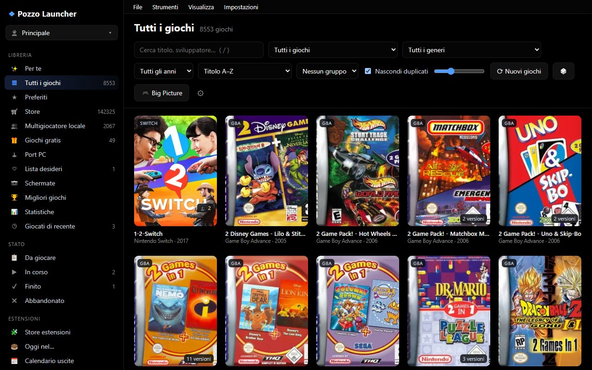
  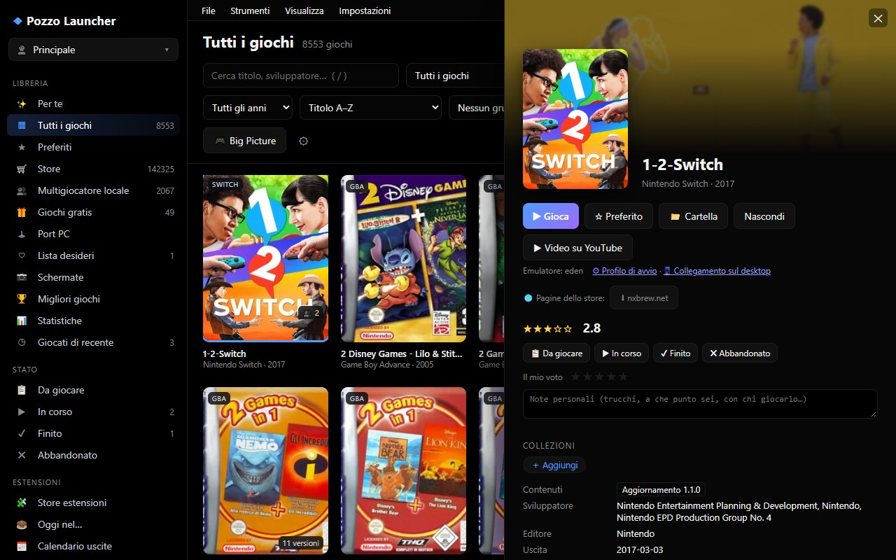
</p>
<p align="center">
  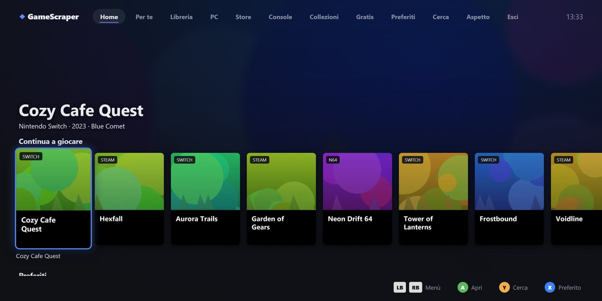
  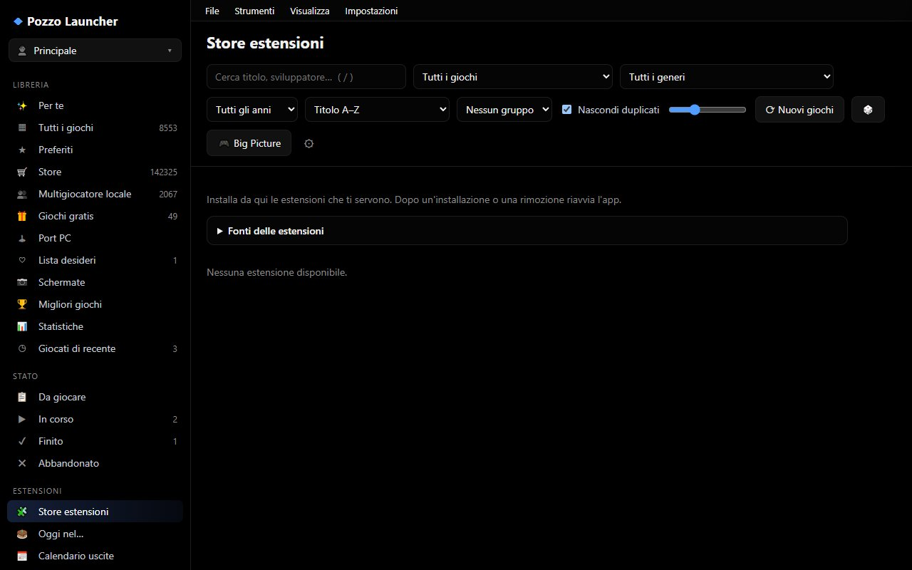
</p>
<p align="center"><sub>Libreria di esempio con giochi di fantasia.</sub></p>

### Grafiche

Ogni grafica cambia il modo di sfogliare la libreria, non solo i colori: si sceglie da **Impostazioni › Aspetto**.

<p align="center">
  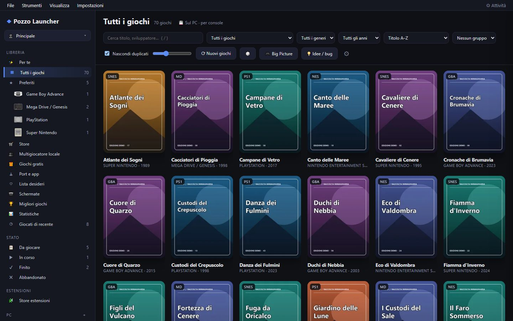
  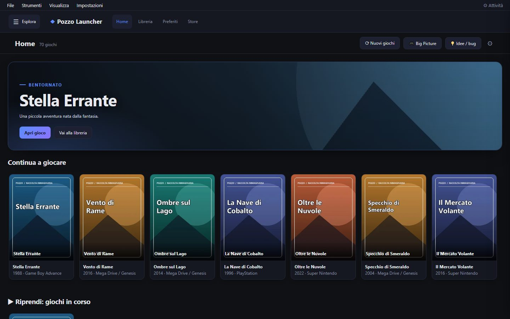
</p>
<p align="center">
  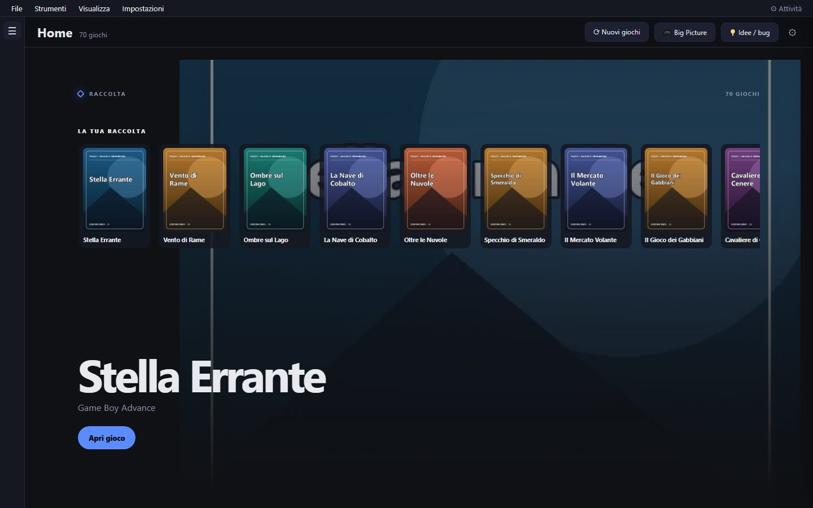
  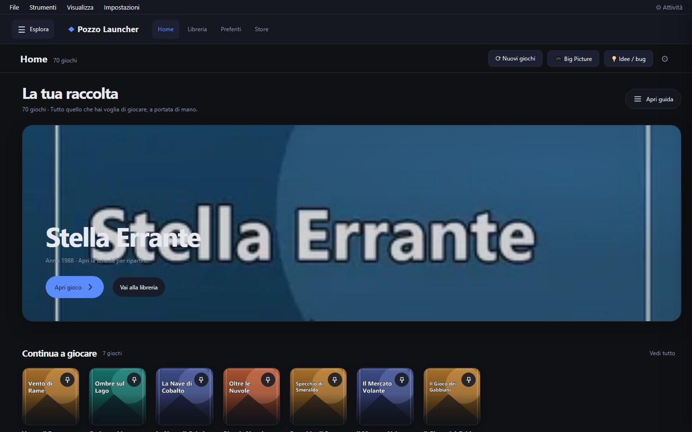
</p>
<p align="center">
  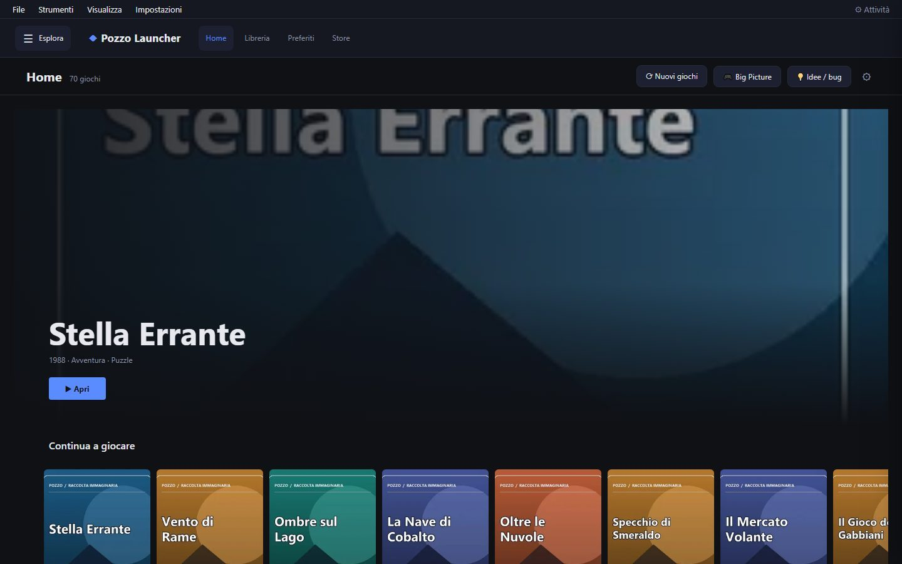
  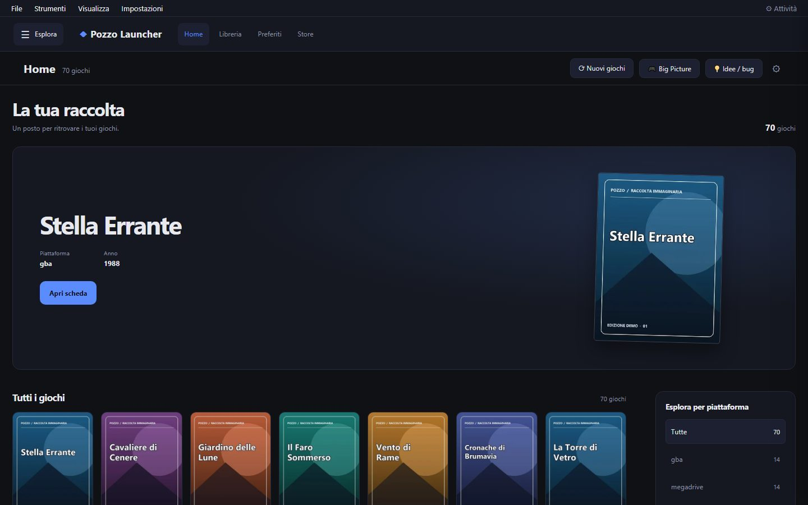
</p>
<p align="center"><sub>Catalogo · Scaffali · Console · Dashboard · Cinema · Vetrina (c'è anche Originale, la vista storica).</sub></p>

### Temi

I temi sono indipendenti dalla grafica e si possono combinare.

<p align="center">
  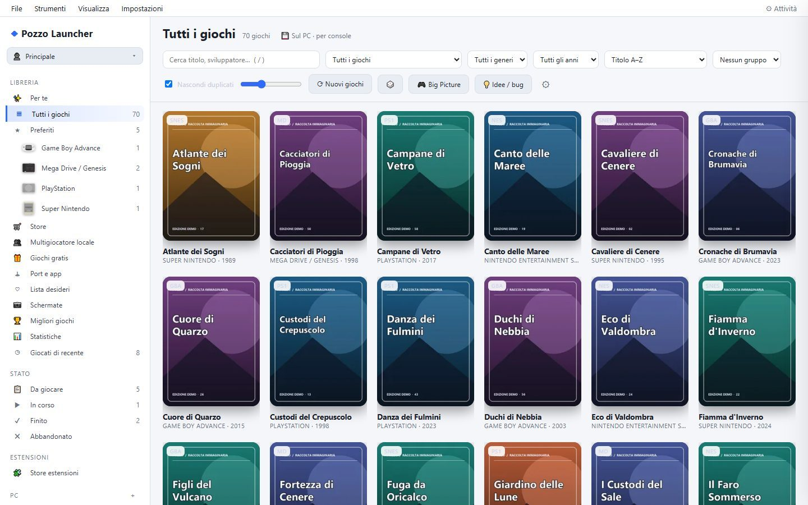
  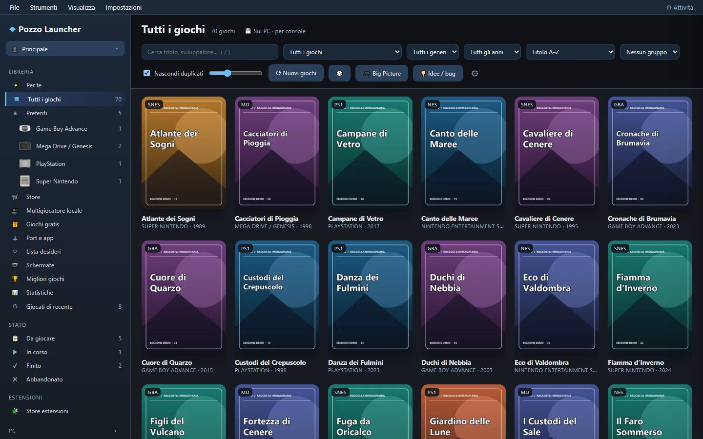
</p>
<p align="center">
  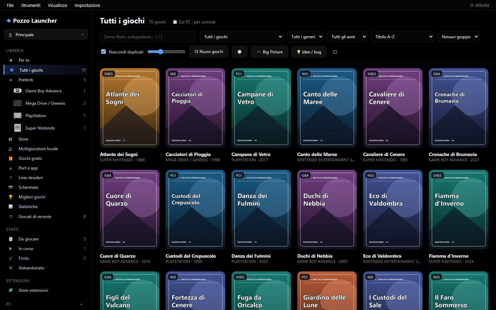
  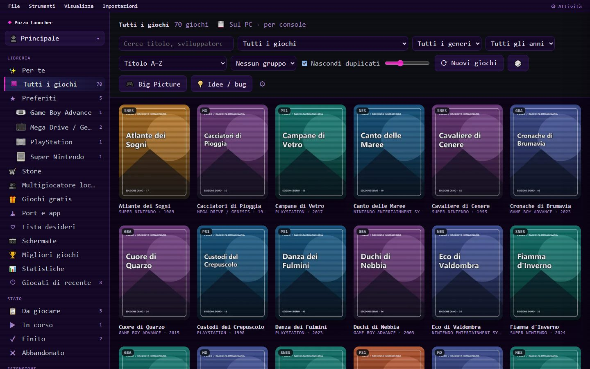
</p>
<p align="center">
  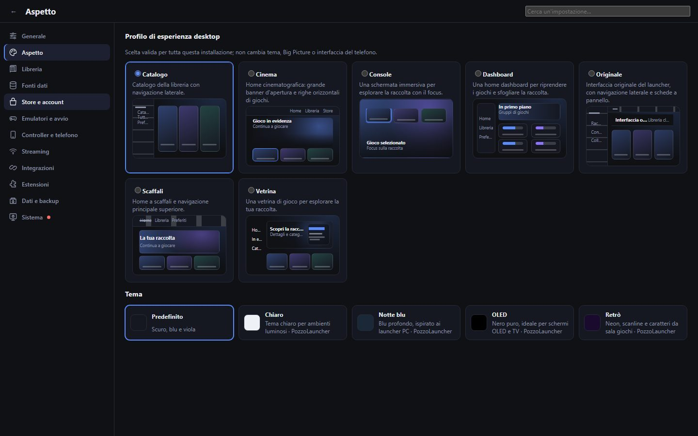
</p>

## Cosa fa

- **Scraping veloce**: riconosce le ROM offline (CRC e nome sui DAT No-Intro/Redump) e interroga le fonti online solo per ciò che manca, rispettando i loro limiti. Riprende da dove si era fermato.
- **Libreria in stile Playnite**: console e store insieme, versioni regionali unite, preferiti (anche per console), stati, collezioni, ricerca e filtri, anche con decine di migliaia di giochi. Una barra dei menu in alto dà accesso rapido alle azioni e alle impostazioni più usate.
- **Giochi PC**: Steam, Epic, GOG, Amazon, Battle.net, Xbox e altri, accanto alle ROM. Puoi aggiungere a mano qualsiasi `.exe` (gioco o applicazione): compare subito e copertina e dati arrivano dopo. Ogni gioco può avviare con sé altre applicazioni (per esempio un deck tracker).
- **Big Picture**: schermo intero pensato per il controller, anche da divano.
- **Telefono e streaming**: sfoglia e avvia i giochi dal telefono, che diventa anche un controller (giroscopio compreso); streaming con Sunshine e Moonlight.
- **Store online**: elenchi di giochi di altri siti, aggiunti come «store» di ogni console.
- **Grafiche e temi**: sette grafiche (Catalogo, Scaffali, Console, Dashboard, Cinema, Vetrina, Originale) e temi chiaro, notte blu, OLED, retrò, combinabili a piacere.
- **Estensioni**: le estensioni si installano da uno store dentro l'app (cosa gioco stasera, obiettivi, calendario uscite, diario di gioco…).
- **Extra**: giochi gratis, lista desideri con prezzi, port PC, copie dei salvataggi, Discord, esportazione per ES-DE e Pegasus.

## Download

Gli eseguibili sono nella pagina **[Releases](https://github.com/erpaffo/Pozzo-Launcher/releases)**:

| Sistema | Installer | Portatile |
|---|---|---|
| Windows 10/11 (64 bit) | `PozzoLauncher-<versione>-windows-x64-setup.exe` | `…-windows-x64.zip`: estrai e apri `PozzoLauncher.exe` |
| macOS 11+ (Apple Silicon) | `…-macos-arm64.dmg`: trascina l'app in Applicazioni | `…-macos-arm64.zip` |
| Linux (64 bit) | `pozzo_<versione>_amd64.deb` (Debian, Ubuntu, Mint…) | `…-linux-x64.tar.gz` |

Gli eseguibili non sono firmati: su Windows SmartScreen chiede conferma (*Ulteriori informazioni › Esegui comunque*), su macOS la prima volta apri l'app con clic destro › Apri.

**Aggiornamenti**: quando esce una versione nuova compare un avviso, e da **Impostazioni › Info** si installa con un clic (**⬇ Installa e riavvia**). I tuoi dati restano.

## Per iniziare

1. Apri Pozzo Launcher e scegli la cartella delle ROM in **Impostazioni › Nuovi giochi**.
2. Avvia la ricerca: la libreria si riempie, e copertine e dati arrivano in sottofondo.
3. Per i giochi PC, collega gli store da **Impostazioni › Store**.

Configurazione, cache e libreria stanno nella cartella dell'utente (`%LOCALAPPDATA%\PozzoLauncher` su Windows, `~/Library/Application Support/PozzoLauncher` su macOS, `~/.local/share/PozzoLauncher` su Linux). Tutto il resto (credenziali delle fonti, comandi da terminale, store online, telefono, estensioni) è nel [manuale](https://erpaffo.github.io/Pozzo-Launcher/).

## Dai sorgenti

```powershell
python -m pip install -r requirements.txt
python -m pozzo app          # apre l'app
python -m pozzo run          # solo scansione e scraping, da terminale
```

Struttura del codice, come creare gli eseguibili e confronto con Skyscraper: [Sviluppo](docs/sviluppo.md). Per contribuire: [CONTRIBUTING.md](CONTRIBUTING.md).

## Avvertenze

Pozzo Launcher è un gestore di librerie: **non contiene, non ospita e non distribuisce giochi, ROM, BIOS o chiavi**. Usalo con giochi che possiedi legalmente e nel rispetto delle leggi del tuo paese e dei termini dei siti a cui ti colleghi: la responsabilità dei contenuti che aggiungi è tua.

I nomi e i marchi di console, giochi e store citati appartengono ai rispettivi proprietari. Pozzo Launcher non è affiliato né approvato da nessuno di loro.

[Privacy](PRIVACY.md) · [Sicurezza](SECURITY.md) · [Codice di condotta](CODE_OF_CONDUCT.md) · [Componenti di terze parti](THIRD_PARTY_NOTICES.md)
