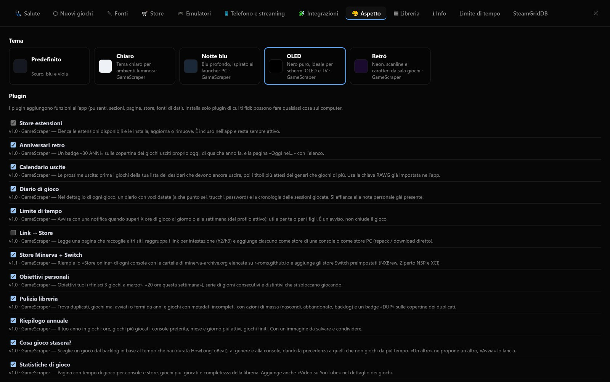
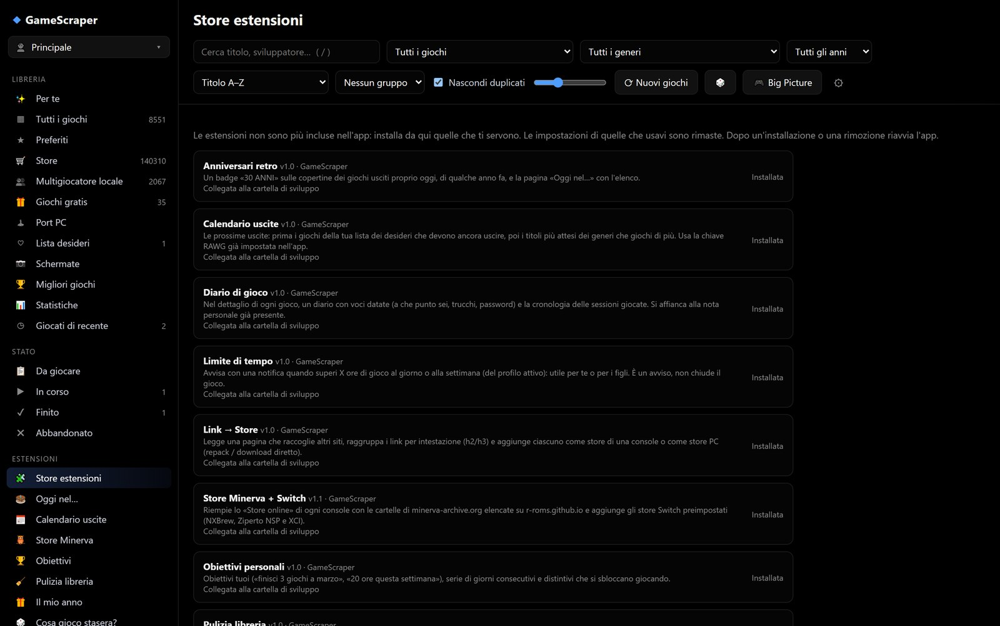

# Temi e plugin di Pozzo Launcher

Pozzo Launcher si personalizza in due modi:

| | Per chi | Cosa cambia | Linguaggio |
|---|---|---|---|
| **Tema** | Chiunque | Colori, caratteri, forme, sfondi, layout | Solo CSS |
| **Plugin** | Chi programma | Nuove funzioni: pulsanti, pagine, store, fonti di dati, reazioni agli eventi | JavaScript e/o Python |

Le cartelle si trovano accanto a `config.toml`:

```
PozzoLauncher/
  config.toml
  themes/<id-tema>/
  plugins/<id-plugin>/
```

Temi e plugin si attivano da **Impostazioni › Aspetto**. Dopo aver aggiunto o abilitato un plugin, riavvia l'app.

---

## Temi

```
themes/mio-tema/
  theme.json
  theme.css          # vista normale
  bigpicture.css     # facoltativo: modalità Big Picture (se manca, usa "desktop")
```

**theme.json**
```json
{
  "name": "Il mio tema",
  "description": "Verde scuro",
  "author": "Io",
  "preview": "#0f1f14",
  "desktop": "theme.css",
  "bigpicture": "bigpicture.css"
}
```

**theme.css**: di solito basta ridefinire le variabili.
```css
:root {
  --bg: #0b140e;        /* sfondo */
  --bg-2: #102016;      /* barra laterale, campi */
  --bg-3: #183024;      /* elementi in rilievo */
  --panel: #0f1d14;     /* pannello dettaglio, finestre */
  --line: #24442f;      /* bordi */
  --text: #e9f5ec;
  --muted: #8fb39a;
  --accent: #3ddc84;    /* colore principale (selezione, pulsanti) */
  --accent-2: #00b894;  /* secondo colore dei gradienti */
  --fav: #ffd54a;
  --radius: 14px;       /* arrotondamento delle copertine */
}
```

Puoi anche cambiare qualsiasi elemento: `.tile`, `.cover`, `#sidebar`, `#detail`, `.btn.primary`… Nella Big Picture: `.card`, `.shelf`, `.bp-hero`, `.bp-btn`… Per i font esterni si può usare `@import` da Google Fonts.

Sulla pagina sono disponibili due attributi utili:

| Attributo | Valori |
|---|---|
| `<html data-mode>` | `desktop` / `bigpicture` |
| `<html data-theme>` | id del tema attivo |

I temi inclusi (`pozzo/app/themes/`: OLED, Chiaro, Retrò, Notte blu) sono buoni esempi da copiare.

In **Impostazioni › Aspetto** si sceglie il tema e si vede l'anteprima del colore di ciascuno:



---

## Plugin

```
plugins/mio-plugin/
  plugin.toml      # obbligatorio
  frontend.js      # facoltativo: interfaccia
  style.css        # facoltativo
  backend.py       # facoltativo: Python, lato server
```

**plugin.toml**
```toml
[plugin]
name = "Il mio plugin"
version = "1.0"
author = "Io"
description = "Cosa fa"
api = 1
```

### Interfaccia (frontend.js)

È un modulo JavaScript che esporta una funzione. Riceve `gs`, l'API dell'app, che funziona sia nella vista normale sia nella Big Picture:

```js
export default function (gs, ctx) {
  // pulsante nel dettaglio di ogni gioco
  gs.addGameAction({
    id: "wiki", label: "Wiki", icon: "📖",
    when: (game) => !game.store,          // facoltativo: solo per alcuni giochi
    run: (game) => gs.api("/api/open", { body: { url: "https://it.wikipedia.org/wiki/" + encodeURIComponent(game.title) } }),
  });

  // sezione nel dettaglio (HTML o Element, anche asincrona)
  gs.addDetailSection({ id: "note", title: "Le mie note", render: async (game) => `<p>${gs.esc(game.title)}</p>` });

  // etichetta sulle copertine
  gs.addTileBadge({ id: "retro", render: (g) => (g.year && g.year < 1990 ? "RETRÒ" : null) });

  // voce nella barra laterale che apre una pagina
  gs.addSidebarItem({ id: "mia", label: "La mia pagina", icon: "✨", view: "mia-pagina" });
  gs.registerView("mia-pagina", { title: "La mia pagina", render: (el) => { el.innerHTML = "<h2>Ciao!</h2>"; } });

  // scheda nelle impostazioni
  gs.addSettingsTab({ id: "mio", label: "Mio plugin", render: (el) => { el.innerHTML = "…"; } });

  // eventi dell'interfaccia
  gs.on("gameOpened", (game) => console.log("aperto", game.title));
}
```

**Eventi dell'interfaccia**:
- `libraryLoaded`: libreria caricata o ricaricata;
- `viewChanged`: cambio di vista;
- `gameOpened`: dettaglio di un gioco aperto;
- `uiChanged`: un plugin ha aggiunto elementi;
- `extensionsLoaded`: temi e plugin caricati.

**Funzioni utili**:

| Funzione | Cosa fa |
|---|---|
| `gs.api(path, {body, method})` | Chiama le API dell'app o del tuo backend |
| `gs.library()` | Libreria in memoria (`games`, `plats`, `colls`, …) |
| `gs.openGame(id)` | Apre il dettaglio di un gioco |
| `gs.currentGame()` | Gioco aperto in questo momento |
| `gs.toast(msg, errore)` | Mostra una notifica |
| `gs.esc(testo)` | Rende sicuro un testo da inserire nell'HTML |
| `gs.mode` | `"desktop"` o `"bigpicture"` |

`ctx.settings` contiene le impostazioni salvate dal backend del plugin.

### Server (backend.py)

```python
def register(gs):
    # endpoint: GET /plugin-api/<id-plugin>/ciao
    @gs.route("ciao")
    def ciao():
        return {"messaggio": "ciao", "impostazioni": gs.settings}

    # eventi: game_started, game_stopped, library_built, scrape_finished, stores_refreshed
    gs.on("game_stopped", lambda info: gs.log(f"{info['title']}: {info.get('played', 0):.0f} secondi"))

    # impostazioni persistenti (in settings.json)
    gs.save_settings({"ultimo_avvio": "oggi"})
```

`gs` mette a disposizione:

| Membro | Cosa fa |
|---|---|
| `gs.route(path, methods=("GET",))` | Espone una funzione su `/plugin-api/<id>/<path>` (FastAPI) |
| `gs.add_store(ClasseStore)` | Aggiunge un **fornitore di libreria**, cioè uno store nuovo: sottoclasse di `pozzo.stores.base.StoreProvider`, con un metodo `fetch()` che restituisce `StoreGame` (installati o da installare, con `launch` e `install_uri`) |
| `gs.add_source(ClasseFonte)` | Aggiunge una **fonte di metadati** per lo scraping: sottoclasse di `pozzo.sources.base.Source`, con `lookup(game)` |
| `gs.on(evento, funzione)` | Reagisce agli eventi del server |
| `gs.cfg` | Configurazione (sola lettura) |
| `gs.settings`, `gs.save_settings(dict)` | Impostazioni del plugin |
| `gs.log(msg)` | Scrive nel log |

### Esempio completo

Il plugin **Statistiche** (`extensions/statistiche/`) usa tutte le parti:
- un backend con un endpoint e un evento;
- un frontend con una pagina, una voce nella barra laterale e un'azione nel dettaglio;
- un foglio di stile.

### Store delle estensioni

L'app include un solo plugin: lo **Store estensioni** (`pozzo/app/plugins/estensioni/`). È sempre il primo
della barra laterale e di **Impostazioni › Aspetto**, e non si può disattivare. Tutte le altre estensioni si
installano da lì, nella cartella `plugins/` accanto a `config.toml`. Dopo un'installazione o una rimozione, riavvia l'app.

Le estensioni arrivano dalle **fonti**, elencate in *Fonti delle estensioni* in cima alla pagina:

- la prima è sempre lo **store ufficiale** ([cartella `extensions/` del repository dell'app](https://github.com/erpaffo/Pozzo-Launcher/tree/main/extensions)) e non si toglie;
- **Aggiungi** accetta il link di un repository GitHub (`https://github.com/utente/repo`, anche `/tree/<tag>`) o
  l'indirizzo https di un `index.json`. Se il link è il repository di un'estensione si aggiunge quell'estensione,
  se è un altro store si aggiunge tutto il suo elenco. L'app controlla che il link risponda e contenga estensioni;
- se la stessa estensione è in più fonti vince lo store ufficiale; quelle di altre fonti mostrano «da utente/repo».

Ogni estensione ha il suo `index.json` con l'elenco dei file e il loro sha256. L'installazione scarica i file uno per
uno e scrive su disco solo se **tutti** corrispondono. Rifiuta anche nomi di file con percorsi, sottocartelle e versioni
dell'app più vecchie di `min_app`. Lo sha256 garantisce che i file siano quelli dell'indice, non che l'estensione sia
affidabile: le estensioni di fonti di terzi eseguono codice sul PC, quindi aggiungi solo fonti di cui ti fidi.
Un'estensione collegata alla cartella di sviluppo (vedi sotto) non viene mai aggiornata né cancellata dallo store.

Per provare uno store diverso al posto di quello ufficiale, anche da disco prima del push, imposta in `settings.json`:
`"app": {"extensions_index": "C:/percorso/store/index.json"}`.



### Pubblicare un'estensione

Ogni estensione vive nel **proprio repository** (per esempio `pozzo-ext-stasera`): in cima ci sono
`plugin.toml`, i file dell'estensione (niente sottocartelle) e `index.json`. Lo store ufficiale è un altro repository
con un solo `index.json`, che elenca i repository e la versione approvata di ciascuno:

```json
{"version": 1, "repos": [{"repo": "erpaffo/gamescraper-ext-stasera", "ref": "v1.0"}]}
```

L'app legge l'`index.json` di ogni repository a quel tag. Una voce può anche indicare `"url"` al posto di
`repo`/`ref`, per un indice che non sta su GitHub.

Per pubblicare una versione:

1. In `plugin.toml` alza `version` e, se usa funzioni nuove dell'app, `min_app = "x.y.z"`.
2. Rigenera l'indice dal repository dell'estensione: `python <Pozzo Launcher>/tools/extensions.py index .`
3. Commit, tag `v<versione>` e push.
4. Nello store porta `ref` al tag nuovo (una pull request sul repository dello store). Chi ha aggiunto il repository
   dell'estensione come fonte la vede invece subito, perché quel link segue il ramo principale.

I repository hanno i fine riga fissati a LF (`.gitattributes`): lo sha256 nell'indice è quello dei file come li serve GitHub.

**Dal repository dell'app ai repository separati**: `python tools/extensions.py export <cartella> <utente>` crea in
`<cartella>` un repository pronto per ogni estensione di `extensions/` (file, `index.json`, README, licenza) e quello
dello store, che punta a `<utente>/pozzo-ext-<id>` al tag `v<versione>`.

Per provare un'estensione nell'app, `python tools/extensions.py install [<cartella>]` la **copia** nella tua cartella
`plugins/`: senza argomento quelle di `extensions/`, altrimenti quelle della cartella indicata (una cartella con i
repository clonati, oppure una sola estensione). Dopo ogni modifica va rifatto, e riavviata l'app. Non si usano
collegamenti (junction o symlink): l'app installata non attraversa quelli che puntano dentro OneDrive e
non parte (WinError 448). La release contiene solo lo store.

### Estensioni disponibili

| Plugin | Cosa fa |
|---|---|
| **Statistiche** | tempo di gioco per console e store, giochi più giocati, completezza dei metadati |
| **Link → Store** | legge una pagina che raccoglie altri siti, raggruppa i link per intestazione (h2/h3) e aggiunge ciascuno come store di una console o come store PC (repack / download diretto) |
| **Store Minerva + Switch** | importa in un clic le cartelle di minerva-archive.org elencate su r-roms.github.io **e** aggiunge gli store Switch preimpostati (NXBrew `game-index`, Ziperto NSP, Ziperto XCI) |
| **Cosa gioco stasera?** | propone un gioco dal backlog in base al tempo che hai (durata HowLongToBeat), al genere e alla console, con più probabilità per quelli che non giochi da più tempo; «Un altro» e «Avvia» |
| **Anniversari retro** | badge «30 ANNI» sulle copertine dei giochi usciti proprio oggi e pagina «Oggi nel…» (servono le date di uscita complete) |
| **Pulizia libreria** | duplicati, giochi mai avviati o fermi da anni, dati incompleti; azioni di massa (nascondi, abbandonato, backlog), badge «DUP» e **🧹 Rimuovi doppioni manuali** (voci aggiunte a mano con lo stesso eseguibile e gli stessi argomenti: si tiene la più vecchia) |
| **Diario di gioco** | nel dettaglio di ogni gioco, voci datate e cronologia delle sessioni (si affianca alla nota personale già presente) |
| **Limite di tempo** | notifica quando superi X ore al giorno o a settimana (del profilo attivo); è un avviso, non chiude il gioco |
| **Obiettivi personali** | obiettivi a periodo (giochi finiti, ore, giorni di gioco), serie di giorni consecutivi e distintivi |
| **Riepilogo annuale** | il tuo anno in giochi (ore, più giocati, console, mese) con un'immagine da salvare |
| **SteamGridDB** | fonte di copertine verticali, sfondi e logo mancanti; chiave gratuita in Impostazioni › SteamGridDB. Alimenta anche **🖼 Cerca immagini…** del menu del tasto destro (candidati da scegliere per il singolo gioco) |
| **Calendario uscite** | uscite future dei giochi in lista desideri e dei prossimi titoli dei tuoi generi, da RAWG (usa la chiave di Impostazioni › Fonti) |

**Store Minerva + Switch** tiene i preset in `PRESETS` (`backend.py`): per aggiungerne altri basta una riga
(`{"console": ["https://…"]}`). Poiché gli elenchi della stessa console possono avere formati diversi
(`type_b`, `type_c`, `type_d`), quando una console ha più di un indirizzo il `type` fisso viene rimosso:
ogni pagina viene riconosciuta da sola da `catalog.detect_kind`.

**Link → Store** è anche un esempio di plugin che **scrive nelle impostazioni**: usa le stesse funzioni
dell'interfaccia (`config.set_setting`) e quindi le modifiche valgono subito, senza riavviare l'app.
La logica di lettura della pagina sta in `pozzo/linklist.py` (`scan_page`, `add_store`), fuori dal
plugin, così è testabile senza avviare il server.

### Sicurezza

Un plugin con `backend.py` gira con gli stessi permessi dell'app: può leggere e scrivere file e avviare programmi. Installa solo plugin di cui ti fidi e di cui puoi leggere il codice.
