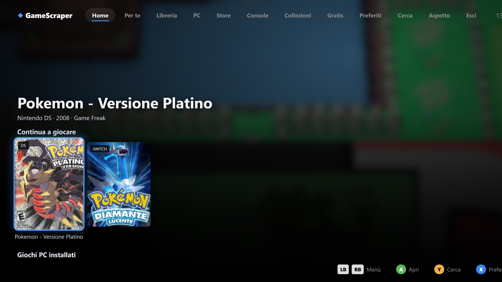

# Big Picture

Big Picture è l'interfaccia a **schermo intero per il controller**, pensata per un PC collegato alla TV.

## Aprirla

- il pulsante **🎮 Big Picture** in alto nella finestra principale;
- `python -m pozzo app --bigpicture` per avviare l'app direttamente a schermo intero;
- `pozzo bigpicture`, che usa l'app già aperta se c'è;
- da Moonlight, con l'app «Pozzo Launcher Big Picture» pubblicata in Sunshine (vedi
  [Telefono e streaming](telefono-streaming.md#streaming-con-sunshine-e-moonlight)).

## Le schermate

- **Home a scaffali**: *Continua a giocare*, *Preferiti*, *Giochi PC installati*, le collezioni più grandi, le
  console, i consigli e le collezioni intelligenti. Sfondo e logo cambiano con il gioco selezionato.
- **Libreria, PC, Console, Collezioni, Preferiti** come griglie navigabili.
- **Ricerca** con la tastiera a schermo.
- **Pagina del gioco** con Gioca o Installa, Preferito, Stato, Versioni e **Togli da Giocati di recente**.
- Il questionario **A cosa vuoi giocare?**, lo stesso della vista *Per te*.

## Comandi

| Controller | Tastiera | Azione |
|---|---|---|
| Croce o levetta | Frecce | Muoversi |
| A | Invio | Conferma |
| B | Esc | Indietro |
| Y | `/` | Cerca |
| X | `F` | Preferito |
| LB / RB | | Scorrere velocemente |
| Select + Start tenuti 2 secondi | | Chiudere il gioco in esecuzione |

Funzionano i controller Xbox, PlayStation, Switch Pro e gli altri riconosciuti dal sistema. La combinazione per
chiudere il gioco funziona anche mentre il gioco è in primo piano, con i controller XInput (Xbox).

## Accessibilità

Nella scheda **Aspetto** di Big Picture:

- **palette per il daltonismo**: deuteranopia, protanopia, tritanopia;
- **alto contrasto**;
- tre **dimensioni dei testi**;
- **suoni dell'interfaccia** per spostamento, conferma, indietro ed errore;
- **lettura vocale** di ciò che si seleziona (regione `aria-live`): funziona con l'Assistente vocale di Windows e con i
  lettori di schermo.

Le scelte restano salvate sul PC.

## Tema

Big Picture usa il tema scelto in **Impostazioni › Aspetto**. Un tema può avere un foglio di stile apposito per
Big Picture (vedi [Temi e plugin](ESTENSIONI.md#temi)).
