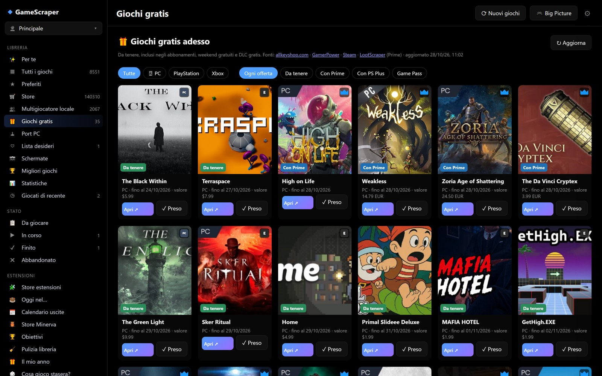
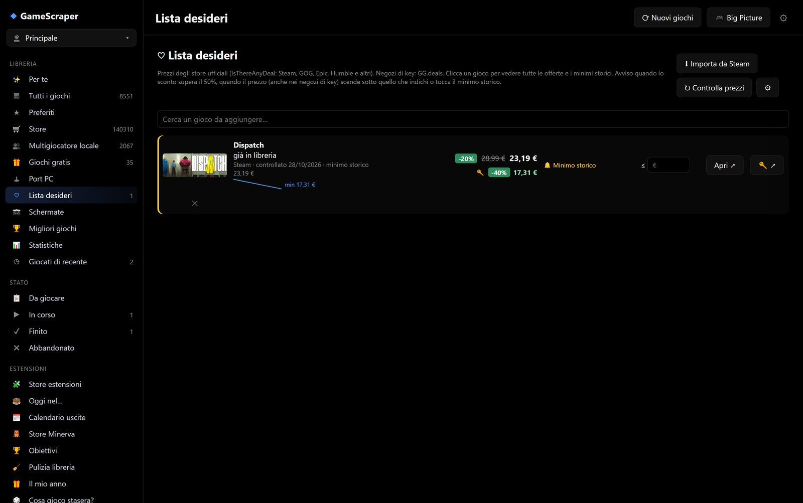
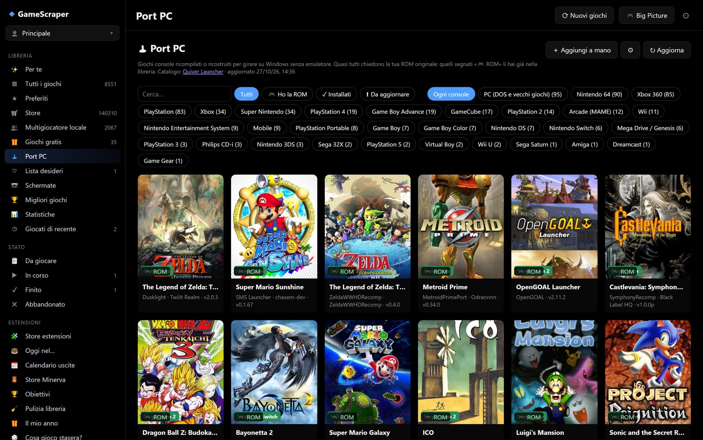

# Giochi gratis, lista desideri, port PC

## Giochi gratis

La vista **🎁 Giochi gratis** raccoglie le offerte gratuite del momento: giochi da tenere, inclusi in abbonamenti,
weekend gratuiti e DLC gratis.

| Fonte | Cosa dà |
|---|---|
| allkeyshop.com (riquadro *Daily game deals*) | Fonte principale: giochi gratis su tutti gli store, con tipo di offerta |
| LootScraper (feed pubblico) | Prime Gaming anche senza allkeyshop: link diretto al riscatto, copertina, scadenza, valore |
| Ricerca di Steam | Giochi normalmente a pagamento scontati del 100% (esclusi free to play, DLC, colonne sonore) |
| GamerPower | Giochi in regalo con data di fine |

Nella pagina:

- l'etichetta **Nuovo** e il numero 🆕 nella barra laterale indicano le offerte comparse dall'ultima visita;
- **✓ Preso** segna un'offerta già riscattata;
- l'ordine mette prima le offerte ancora da prendere, per scadenza più vicina;
- **♡** aggiunge il gioco alla lista desideri.

Le richieste sono poche: il risultato resta in cache 3 ore (12 ore per allkeyshop e Prime Gaming) e dopo un errore di
rete la fonte viene lasciata in pace per 3 ore. Se allkeyshop non risponde (blocca l'indirizzo dopo poche richieste)
si tiene l'ultimo elenco buono. Le copertine remote hanno tempi di attesa brevi, così un sito lento non blocca il
resto dell'app.

## Lista desideri

La vista **♡ Lista desideri** segue i prezzi dei giochi che vuoi comprare e avvisa quando conviene.

### Aggiungere giochi

- cerca un gioco nel campo *Cerca un gioco da aggiungere…*;
- **⬇ Importa da Steam** importa la tua lista desideri di Steam;
- **♡** nella pagina dei giochi gratis.

Un gioco che hai già in libreria è segnato con *già in libreria*.

### Prezzi

| Prezzi | Fonte | Cosa serve |
|---|---|---|
| Store ufficiali (Steam, GOG, Epic, Humble…) | IsThereAnyDeal | Chiave gratuita (⚙ della lista); senza chiave, il prezzo di Steam per i giochi con codice Steam |
| Negozi di key | **allkeyshop** | Niente: ogni gioco aggiunto viene cercato da solo su allkeyshop |
| Negozi di key (in più) | GG.deals | Chiave gratuita (⚙ della lista); solo giochi PC con codice Steam |

Per ogni gioco la lista mostra il prezzo attuale, lo sconto, il **minimo storico** e il prezzo della key più
economica, con lo sconto rispetto al prezzo pieno ufficiale (per esempio 59,99 € su Steam → 18,50 € = −69%).
**🔑 ↗** apre il confronto dei negozi di key, **Apri ↗** la pagina dello store.

### Tutte le offerte di un gioco

Un clic su un gioco della lista apre il dettaglio dei prezzi letto da allkeyshop:

- **Steam**: prezzo e sconto attuali, con il minimo storico di Steam;
- **Key più economica**;
- **tutte le offerte**, con negozio, regione, edizione, coupon e prezzo (le offerte di *account* sono separate dalle
  key);
- il **minimo storico delle key**.

Se allkeyshop ha trovato il gioco sbagliato, o non l'ha trovato, incolla nel dettaglio l'indirizzo della sua pagina
su allkeyshop. **↻ Aggiorna** rimette il gioco in testa alla coda. Collegamenti rapidi: **allkeyshop ↗** e
**Steam ↗**.

allkeyshop blocca chi fa troppe richieste, quindi l'app procede piano: **una richiesta al minuto**, ogni gioco al
massimo una volta al giorno, lo storico una volta al mese, e una **pausa di 6 ore** se il sito rifiuta. La lista
mostra quanti giochi sono in coda (*🔑 key: in coda*) e quanto manca; un gioco che il sito non conosce è segnato
*🔑 non trovato su allkeyshop*.

I prezzi si controllano al massimo due volte al giorno, oppure subito con **↻ Controlla prezzi**. Nelle impostazioni
della lista (⚙) si scelgono anche il **paese** e lo **sconto minimo** per gli avvisi.

### Avvisi e storico

Un avviso (🔔) nasce quando:

- lo sconto supera la soglia scelta;
- il prezzo, ufficiale **o** dei negozi di key, scende sotto quello indicato in *Avvisami quando costa meno di…*;
- il prezzo tocca il **minimo storico** da quando segui il gioco.

Ogni gioco ha uno **storico dei prezzi** (un punto al giorno, store e negozi di key) con un piccolo grafico.

## Port e app

La vista **🕹 Port e app** elenca i giochi console **ricompilati o ricostruiti per Windows** (Zelda64Recomp, Ship of
Harkinian, Banjo Recompiled…) e i **giochi ed emulatori** che si distribuiscono con le release di GitHub/GitLab, dal
catalogo di Quiver Launcher: circa 630 voci, aggiornate ogni 24 ore.

### Trovare un port

Filtri per tipo (port, giochi, emulatori) e per console, ricerca, **🎮 Ho la ROM** (port di giochi che hai già in
libreria), **Installati**, **Da aggiornare**. La scheda di una ROM mostra **Disponibile come port PC** quando ne esiste uno.

### Installare e avviare

- **Installa** scarica l'ultima release da GitHub, GitLab o Codeberg (il file Windows viene scelto da solo) nella
  cartella `Ports\<cartella>`, con `portable.txt` dove il port lo prevede.
- Il file scaricato viene **verificato con lo SHA-256** della release del catalogo (o con il `digest` pubblicato da
  GitHub): se non corrisponde il download viene rifiutato.
- Il port diventa un **gioco PC**: tempo di gioco, Big Picture e avvio dal telefono funzionano come per gli altri.
  Il pulsante **Gioca** è disponibile subito nella scheda del port, anche mentre la libreria si aggiorna, e l'avvio
  passa sempre dal launcher dell'app.
- **Aggiorna tutto** (e l'opzione **Aggiorna da solo** nelle impostazioni della pagina) installa le versioni nuove
  dal launcher: le patch non richiedono di aprire altri programmi.
- Se il port ha più eseguibili si sceglie quale avviare, e la scelta resta ricordata.
- **Disinstalla** sposta la cartella nel Cestino.
- **Aggiungi a mano**: da un repository GitHub (`utente/progetto`) o da una cartella già scaricata.

### ROM richiesta

Molti port richiedono la ROM originale. Per i port che indicano l'hash richiesto, dopo il download l'app cerca
automaticamente nella libreria la ROM giusta, la controlla con l'hash e la copia nella cartella del port. **Copia
dalla libreria** resta disponibile per ripetere l'operazione manualmente. Le impostazioni del port (eseguibile,
ROM e mod) si gestiscono dalla sua scheda nell'app; dalla scheda del gioco si può aprire anche il **Profilo di avvio**
per gli script e le opzioni aggiuntive.

### Aggiornamenti

Il controllo degli aggiornamenti avviene al massimo ogni 12 ore. Prima di aggiornare si fa una copia di sicurezza in
`Ports\.backup`; salvataggi, configurazione e mod (i file della cartella che non vengono dalla release) sono
conservati. **Salta questa versione** ignora un aggiornamento. Un token GitHub facoltativo (⚙ nella pagina) alza il
limite di richieste a GitHub.

### Mod e salvataggi

- **Mod** da Thunderstore: installa e rimuovi dalla pagina del port. GameBanana è disponibile solo come link.
- I **salvataggi** del port entrano nelle copie dei salvataggi per gioco (vedi [Giocare](giocare.md#salvataggi)).

## Avvisi di Windows

Con **Impostazioni › 🧩 Integrazioni › 🔔 Notifiche di Windows** attive (lo sono di base) Pozzo Launcher avvisa con una
notifica di Windows — che resta nel centro notifiche — quando:

- un gioco della lista desideri scende sotto la soglia di prezzo;
- esce un gioco gratis nuovo (Steam, Epic, Prime, store online);
- un port PC installato ha un aggiornamento;
- finisce una ricerca o un aggiornamento (nuovi giochi, store, copertine, durate, database locali…).

I giochi gratis e gli aggiornamenti dei port si controllano in sottofondo ogni 6 e 12 ore, senza dover aprire quelle
pagine. Lo stesso avviso non viene ripetuto per la stessa offerta o la stessa versione.

## Spegnere o sospendere il PC a fine lavori

**Impostazioni › ⟳ Nuovi giochi › 🌙 Al termine delle operazioni**: quando non c'è più niente in corso — scraping,
aggiornamento degli store, download di un port — il PC si **sospende** o si **spegne**. Parte un conto alla rovescia
di 60 secondi con il pulsante **✕ Annulla**, nella stessa pagina. Con un gioco aperto non succede niente finché non lo
chiudi: un gioco non viene mai chiuso da uno spegnimento.
