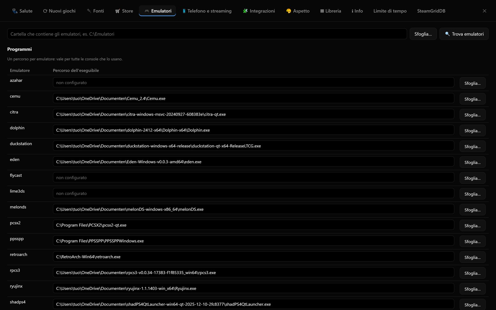
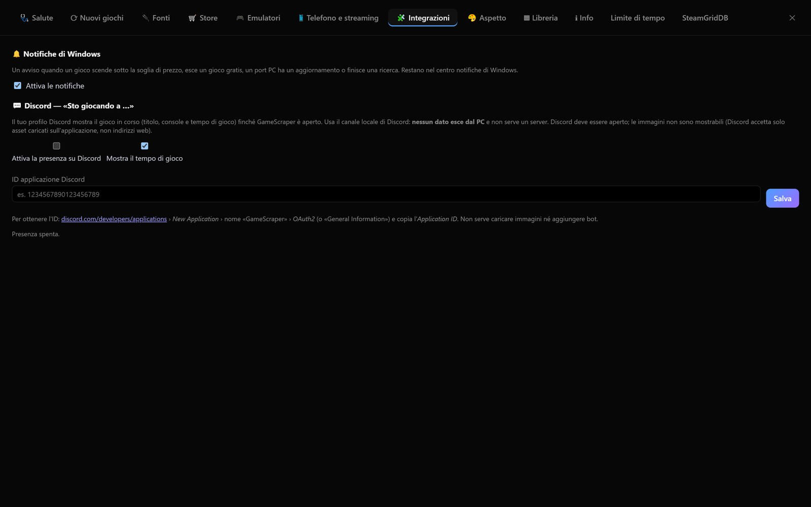

# Giocare

## Configurare gli emulatori

Gli emulatori si configurano in **Impostazioni › Emulatori**, in due tabelle.

**Programmi**: un percorso per emulatore, valido per tutte le console che lo usano. **🔍 Trova emulatori** cerca in
una cartella gli eseguibili conosciuti: RetroArch, Ryujinx, Eden, melonDS, Dolphin, PCSX2, DuckStation, PPSSPP,
RPCS3, Vita3K, Azahar, Cemu, Xenia, xemu, Flycast, shadPS4, SharpEmu. **＋ Aggiungi un altro emulatore** aggiunge un programma
qualsiasi.

**Emulatore per console**: per ogni console scegli

- l'**emulatore**: *Automatico* usa il primo installato tra quelli consigliati per quella console; *Altro…* permette
  qualsiasi emulatore esterno;
- il **core** di RetroArch, se la console usa RetroArch;
- gli **argomenti**: `{rom}` è il file del gioco, `{core}` il core di RetroArch.

La colonna **Stato** dice cosa manca (emulatore non trovato, core assente…). Le scelte vanno in `settings.json`; il
`config.toml` non viene mai riscritto. In `config.toml` si possono indicare gli stessi percorsi in `[emulators]` e
sovrascrivere il comando di una console in `[launch.<console>]` (vedi [Riferimento](riferimento.md)).

### Profilo di avvio di un singolo gioco

Nel dettaglio di un gioco, **⚙ Profilo di avvio** cambia il modo di avviare **solo quel gioco** (tutte le sue
versioni). I campi vuoti usano le impostazioni della console:

- emulatore e core RetroArch;
- eseguibile diverso (per esempio un'altra versione dell'emulatore);
- argomenti al posto di quelli predefiniti;
- argomenti aggiuntivi, messi prima del file del gioco (per esempio `-f` per lo schermo intero);
- **script prima dell'avvio** e **script dopo la chiusura** (vedi sotto);
- **app da avviare insieme al gioco**: un eseguibile con i suoi argomenti e l'opzione **Chiudi l'app quando il gioco
  finisce**. Serve per i programmi che devono girare accanto al gioco, per esempio un deck tracker su Hearthstone o un
  overlay di statistiche: si avvia con il gioco e, se vuoi, si chiude con lui.

Per i giochi PC il profilo contiene i due script e l'app di accompagnamento: il gioco si avvia sempre come prevede il
suo store.

## Script prima e dopo il gioco

In **Impostazioni › Emulatori › Avvio dei giochi** si indicano due script eseguiti per **tutti i giochi**, console e
PC:

- **Prima dell'avvio**: per esempio per cambiare la risoluzione dello schermo o attivare l'HDR;
- **Dopo la chiusura**: per rimettere le cose com'erano.

Uno script è un comando oppure un file `.bat` o `.ps1`. Riceve due variabili d'ambiente: `POZZO_TITLE` (titolo
del gioco) e `POZZO_KEY` (chiave del gioco nella libreria), così lo stesso script può comportarsi diversamente
per giochi diversi.

Ogni gioco può avere i suoi script nel **⚙ Profilo di avvio**: vengono eseguiti **dopo** quelli di tutti i giochi.

## Chiudere il launcher dello store

Sempre in **Impostazioni › Emulatori › Avvio dei giochi**, l'opzione **Chiudi il launcher dello store** chiude a fine
partita Steam, Epic, GOG Galaxy, Battle.net o Amazon Games, **solo se l'aveva aperto il gioco**: un launcher che era
già aperto prima resta aperto. La chiusura avviene qualche secondo dopo la fine della partita, così il launcher
finisce di sincronizzare i salvataggi; Steam viene chiuso in modo pulito.

## Collegamento sul desktop

Nel dettaglio di un gioco, **🖥 Collegamento sul desktop** crea un collegamento con l'icona del gioco: quella
dell'eseguibile per i giochi PC avviati da un `.exe`, altrimenti ricavata dalla copertina. Il collegamento avvia il gioco **tramite
Pozzo Launcher**: valgono emulatore, profilo e script, e il tempo di gioco viene registrato come quando lo avvii
dall'app. Non è disponibile per i giochi degli store online, che non sono installati.

## Avviare un gioco

**▶ Gioca**, `Invio` o un doppio clic sulla copertina. L'app sceglie da sola il file giusto:

- gli **ZIP di dischi** (per esempio i GameCube di Myrient) vengono estratti automaticamente prima dell'avvio;
- per i **giochi a cartella** si avvia il file corretto (PS3 → `EBOOT.BIN`, PS5 → `eboot.bin` con SharpEmu,
  Switch → il file del gioco base, non un aggiornamento o un DLC);
- con un emulatore mancante il dettaglio lo dice chiaramente, con il collegamento alle impostazioni.

Durante la partita la barra **In esecuzione** mostra il gioco in corso e permette di chiuderlo.

### Chiudere il gioco con il controller

**Select + Start (View + Menu) tenuti premuti per 2 secondi** chiudono il gioco in esecuzione, anche mentre il gioco
è in primo piano, con i controller XInput (Xbox). Si disattiva con `[app] exit_combo = false`.

## Tempo di gioco e partite

Per ogni gioco l'app registra **tempo di gioco**, **ultima partita** e **numero di avvii**. Una partita entra subito
tra i *Giocati di recente* e nello stato *In corso* appena parte, da qualunque dispositivo (PC, telefono, Moonlight);
l'app sul PC se ne accorge entro pochi secondi.

Per i giochi PC avviati tramite un launcher (Steam, Epic…) il tempo viene registrato riconoscendo il processo del
gioco nella sua cartella. Steam fornisce anche il suo tempo totale, mostrato a parte.

## Mostrare su Discord cosa stai giocando

In **Impostazioni › 🧩 Integrazioni** si attiva la **presenza su Discord**: il tuo profilo mostra *«Sto giocando a …»*
con titolo, console e tempo di sessione. Serve solo l'**ID applicazione** — gratis, da
`discord.com/developers/applications` › *New Application* — e il client Discord aperto.

Usa il **canale locale** di Discord (`named pipe`): nessun dato esce dal PC, nessun server, nessuna chiave. Le immagini
non si possono mostrare, perché Discord accetta solo asset caricati sull'applicazione e non indirizzi web.

## Salvataggi

Nel dettaglio, **💾 Salvataggi** tiene una **versione prima e una dopo ogni partita** (se i salvataggi non superano
1 GB; oltre quella misura solo a mano, per non riempire il disco in silenzio), più:

- **Copia adesso** per farne una a mano;
- **↶ Annulla l'ultima partita**, che riporta i salvataggi a com'erano prima dell'ultima partita;
- **Ripristina** su una versione qualsiasi: prima copia i salvataggi attuali, quindi si può tornare indietro; il
  ripristino riscrive i file della copia ma non cancella quelli creati dopo. A gioco aperto il ripristino è bloccato,
  perché l'emulatore riscriverebbe i suoi file;
- **★** fissa una versione (non viene mai cancellata), **✎** le aggiunge una nota (per esempio «prima del boss»),
  **Confronta** dice quali file cambierebbero rispetto ai salvataggi attuali.

Si tengono le ultime **20 versioni** per gioco; quelle fissate non contano. Le versioni stanno nella cartella scelta
in **Impostazioni › Libreria › Salvataggi dei giochi** (di base `<cache>/saves`), una cartella per gioco.

Quando un gioco ha **file condivisi con altri giochi** — le memory card di PCSX2, DuckStation, Dolphin o le VMU di
Flycast — l'app lo segnala: ripristinando torna indietro anche il salvataggio degli altri giochi.

### Dove stanno i salvataggi

I salvataggi si riconoscono per singolo gioco, così le copie non si mescolano:

| Emulatore | Come si riconoscono i salvataggi |
|---|---|
| Eden, yuzu (e suyu, citron) | Title ID nel percorso: `nand/user/save/…/<TITLEID>` |
| Ryujinx | Title ID nei primi byte di `ExtraData0` |
| RetroArch | `.srm` e `.state*` con il nome della ROM, anche nelle sottocartelle per core |
| Dolphin | memory card `.gci` (`GC/<regione>/Card ?`) e `Wii/title/00010000/<ID>`, più `StateSaves/` |
| PCSX2 | stati `sstates/<seriale> (<crc>)`; le memory card `.ps2` sono condivise |
| DuckStation | memory card e stati col nome o il seriale del gioco; `shared_card_*` è condivisa |
| PPSSPP | `PSP/SAVEDATA/<seriale>*` e `PSP/PPSSPP_STATE/<seriale>*` |
| RPCS3 | `dev_hdd0/home/00000001/savedata/<TITLEID>*` |
| Vita3K | `ux0/user/00/savedata/<TITLEID>` |
| melonDS | `<ROM>.sav` e `<ROM>.ml*` accanto alla ROM |
| Azahar, Lime3DS, Citra | `sdmc/Nintendo 3DS/…/title/00040000/<id>/data` e `states/<TITLEID>.*` |
| Cemu | `mlc01/usr/save/00050000/<id>` |
| Flycast | `<ROM>_vmu_save_*.bin`, `<ROM>.nvmem*` (le `vmu_save_*.bin` sono condivise) |
| shadPS4 | `user/savedata/1/<CUSA…>` |

Per **xemu** (un unico disco) e **Xenia** (l'ID non si ricava dal file) il percorso va indicato a mano.

### Percorsi aggiunti a mano

Se l'app non trova i salvataggi, nel riquadro **💾 Salvataggi** si scrive la cartella (o il file) dove li tiene il
gioco, per esempio `%APPDATA%\Gioco\Saves`; le variabili `%VARIABILE%` funzionano anche su Linux e macOS. Vale anche
per i **giochi PC**.

A fine partita, se i salvataggi del gioco non erano ancora noti, l'app propone le cartelle cambiate mentre giocavi:
**Sono i salvataggi** le aggiunge, **Ignora** la scarta.

### Giochi PC: le posizioni del manifest di Ludusavi

Per i giochi PC le posizioni dei salvataggi arrivano dal **manifest di Ludusavi** (oltre 50.000 giochi, aggiornato
ogni settimana, scaricato in sottofondo una volta a settimana). L'app riconosce il gioco per ID Steam o GOG, per titolo
o per cartella di installazione, e copia solo i file che il manifest indica come salvataggi. Le chiavi di registro di
Windows non sono gestite: in quel caso il percorso si aggiunge a mano.

### Formato delle copie: compatibile con Ludusavi

Le versioni sono nel **formato di Ludusavi**: per ogni gioco una cartella con `mapping.yaml` e i file
`backup-<data>.zip`, con dentro i percorsi originali, l'hash SHA-1 e la dimensione di ogni file. Scegliendo in
**Impostazioni › Libreria › Salvataggi dei giochi** la **stessa cartella** di Ludusavi (*Backup mode › Backup target*),
i due programmi vedono e ripristinano le stesse copie. Si vedono solo le copie **complete** (le differenziali di
Ludusavi no). Le copie già fatte nel formato precedente vengono convertite da sole al primo avvio.

Per i port PC vengono copiati i file della cartella del port che non vengono dalla release. Le copie si disattivano
con `[app] save_backups = false`.

## Schermate

Dopo ogni partita l'app importa le schermate fatte dall'emulatore (Ryujinx, Eden e derivati, e gli altri
supportati). Per Eden cerca nella cartella predefinita `%APPDATA%\eden\screenshots`, nella versione portatile
`user\screenshots` accanto all'exe e nel percorso personalizzato letto da `qt-config.ini`. Le schermate si sfogliano
nella vista **📷 Schermate** e si possono fare anche dal telefono.

## RetroAchievements

In **Impostazioni › Store › RetroAchievements** inserisci il tuo utente e la Web API key. Nel dettaglio dei giochi
retro compaiono gli **obiettivi sbloccati**, la percentuale e le icone.

Il gioco viene abbinato:

1. per **hash**: l'MD5 è già noto dal DAT No-Intro, quindi funziona anche con le ROM in `.zip` e con le versioni
   italiane (che su RetroAchievements hanno il titolo inglese);
2. altrimenti per titolo, nome canonico o nome del file.

Cache: catalogo 7 giorni, abbinamento 30 giorni, progresso 30 minuti.
