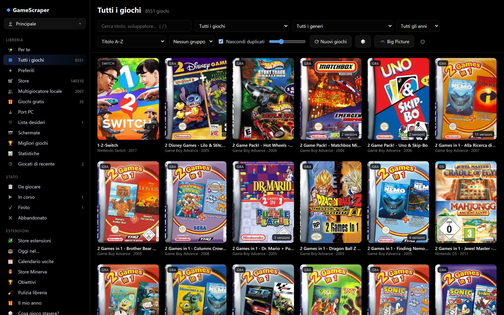

# Introduzione

Pozzo Launcher è una libreria di giochi per il PC: raccoglie in un'unica finestra le **ROM delle console** che hai sul
disco e i **giochi PC** dei tuoi store (Steam, Epic, GOG, Amazon, Battle.net, Xbox, Minecraft), li completa con
copertine, descrizioni, valutazioni e durate, e li avvia con un doppio clic.

> Il manuale è disponibile anche in PDF: [PozzoLauncher-manuale.pdf](PozzoLauncher-manuale.pdf), lo stesso testo di
> queste pagine con un indice completo. Si trova anche tra i file di ogni release su GitHub.

## Cosa fa

| Area | In breve | Capitolo |
|---|---|---|
| Libreria | Griglia di copertine con ricerca istantanea, filtri, collezioni automatiche e personali, consigli | [La libreria](libreria.md) |
| ROM | Riconosce le cartelle delle console, identifica i giochi offline e scarica dati e immagini da molte fonti | [ROM e scraping dei dati](rom-e-scraping.md) |
| Giocare | Avvia ogni gioco con l'emulatore giusto, registra il tempo di gioco, copia i salvataggi | [Giocare](giocare.md) |
| Giochi PC | Giochi installati e posseduti degli store ufficiali, più qualsiasi `.exe` | [Giochi PC dagli store](store-pc.md) |
| Store online | Cataloghi di giochi da scaricare per console e PC, letti da pagine web che scegli tu | [Aggiungere store](store-online.md) |
| Extra | Giochi gratis, lista desideri con prezzi, port PC dei giochi console | [Giochi gratis, lista desideri, port PC](extra.md) |
| Telefono | Il telefono come telecomando, controller (anche più giocatori) e schermo con Moonlight | [Telefono e streaming](telefono-streaming.md) |
| TV | Interfaccia a schermo intero per il controller | [Big Picture](bigpicture.md) |
| Personalizzazione | Temi (solo CSS) e plugin (JavaScript e Python) | [Temi e plugin](ESTENSIONI.md) |
| Più PC e più persone | Sincronizzazione dei dati tra due PC (cartella condivisa o rete locale) e profili utente separati | [Dati e manutenzione](manutenzione.md#sincronizzazione-tra-pc), [Profili](libreria.md#profili-utente) |
| Integrazioni | Presenza su Discord con il gioco in corso, avvisi di Windows, libreria esportata come pagina web statica | [Giocare](giocare.md#mostrare-su-discord-cosa-stai-giocando), [Avvisi](extra.md#avvisi-di-windows), [Dati e manutenzione](manutenzione.md#esportare-per-altri-frontend) |
| Manutenzione | Copie di sicurezza, pagina Salute, cartelle rinominate, esportazione | [Dati e manutenzione](manutenzione.md) |

## Come è fatta l'app

Pozzo Launcher è un piccolo **server locale** (Python, FastAPI) con un'interfaccia web mostrata in una finestra nativa.
Il server risponde solo al PC su cui gira; il telefono può collegarsi solo dopo un abbinamento esplicito
(vedi [Telefono e streaming](telefono-streaming.md)).

Il server espone anche un'**API locale** con token, per script, Stream Deck, Home Assistant e webhook: gli endpoint
`/api/v1` restano gli stessi tra le versioni e non vanno pubblicati su Internet
(vedi [Riferimento › API locale](riferimento.md#api-locale)).

I dati stanno in due posti distinti:

- la **libreria** (`cache/library.db`): giochi, dati scaricati e collezioni automatiche. Si ricostruisce da sola
  dopo ogni scansione o aggiornamento degli store;
- i **tuoi dati** (`cache/userdata.db` e `settings.json`): preferiti, tempo di gioco, stati, note, collezioni tue,
  impostazioni. Non vengono mai toccati da una ricostruzione e hanno copie di sicurezza automatiche.

## Come leggere questo manuale

- I percorsi dell'interfaccia sono scritti così: **Impostazioni › Store › Aggiornamento degli store**.
- I nomi dei pulsanti sono in grassetto, come compaiono nell'app (per esempio **⟳ Nuovi giochi**).
- I file e le chiavi di configurazione sono in `carattere fisso`. Tutte le chiavi sono raccolte nel
  [Riferimento](riferimento.md).
- Le **immagini** sono scattate dall'app vera: mostrano dove si trova ogni cosa e come appare sullo schermo.
- Il capitolo più tecnico è [Aggiungere store](store-online.md): spiega i formati delle pagine che l'app sa leggere
  e come scrivere uno store nuovo come plugin.
