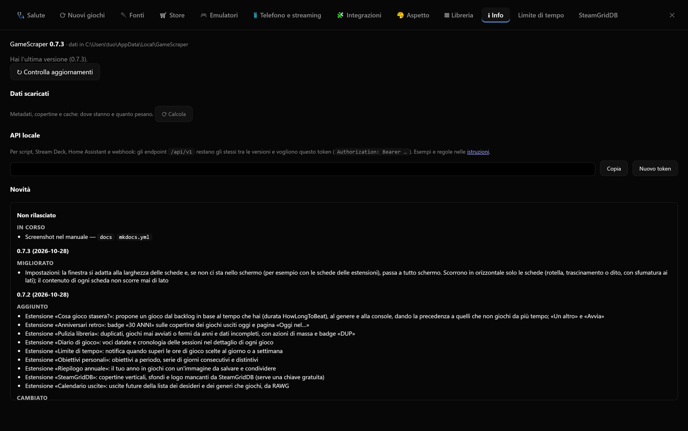

# Installazione e aggiornamenti

## Scegliere il file giusto

Ogni versione è pubblicata nella pagina **Releases** del repository, con due file per sistema operativo:
un **installer** e una versione **portatile**.

| Sistema | Installer | Portatile |
|---|---|---|
| Windows 10/11 (64 bit) | `PozzoLauncher-<versione>-windows-x64-setup.exe` | `PozzoLauncher-<versione>-windows-x64.zip` |
| macOS 11+ (Apple Silicon) | `PozzoLauncher-<versione>-macos-arm64.dmg` | `PozzoLauncher-<versione>-macos-arm64.zip` |
| Linux (64 bit) | `pozzo_<versione>_amd64.deb` | `PozzoLauncher-<versione>-linux-x64.tar.gz` |

**Installer o portatile?**

- L'**installer** mette l'app tra i programmi, crea il collegamento nel menu Start (e, se vuoi, sul desktop) e
  permette di disinstallarla dalle impostazioni del sistema. Su Windows installa per il solo utente corrente
  (`%LOCALAPPDATA%\Programs\PozzoLauncher`) e **non chiede i permessi di amministratore**.
- La versione **portatile** è una cartella da estrarre dove vuoi, anche su un disco esterno. Non installa niente.

### Windows

- Installer: apri il `setup.exe` e segui i passaggi.
- Portatile: estrai lo zip e apri `PozzoLauncher.exe`.

Gli eseguibili non sono firmati: SmartScreen chiede conferma (**Ulteriori informazioni › Esegui comunque**).

### macOS

- `.dmg`: aprilo e trascina **Pozzo Launcher** nella cartella **Applicazioni**.
- `.zip`: estrai e apri `PozzoLauncher.app`.

La prima volta apri l'app con **clic destro › Apri** (l'app non è firmata), oppure da Terminale:
`xattr -cr /Applications/PozzoLauncher.app`.

### Linux

- `.deb` (Debian, Ubuntu, Mint e derivate): `sudo apt install ./pozzo_<versione>_amd64.deb`. Installa anche
  le librerie di sistema necessarie, il collegamento nel menu delle applicazioni e il comando `pozzo`.
- `.tar.gz`: estrai e avvia `PozzoLauncher/PozzoLauncher`. Su installazioni minimali possono servire le librerie della
  finestra Qt: `libegl1 libnss3 libxkbcommon-x11-0 libxcb-cursor0 libxcb-icccm4 libxcb-image0 libxcb-keysyms1
  libxcb-randr0 libxcb-render-util0 libxcb-shape0 libxcb-xfixes0 libxcb-xinerama0 libxcb-xkb1`.

Se la finestra nativa non si può aprire, l'app si apre nel browser predefinito.

## Primo avvio: la configurazione guidata

Al primo avvio compare la **configurazione guidata**, in cinque passi:

1. **Benvenuto**: mostra dove verranno salvati i tuoi dati.
2. **Cartella ROM**: scegli la cartella che contiene le cartelle delle console (per esempio `D:\ROM` con dentro
   `snes`, `psx`, `Nintendo - Game Boy Advance`…). **Verifica** mostra le console riconosciute. Se non hai ROM,
   spunta *Non ho ROM: voglio solo i giochi PC degli store*.
3. **Store PC**: gli store trovati su questo PC, da importare. Gli account (Epic, GOG, chiave Steam) si collegano
   dopo da **Impostazioni › Store**.
4. **Fonti online**: account facoltativi delle fonti di dati (ScreenScraper, IGDB, RAWG, TheGamesDB). Senza account
   l'app usa comunque le fonti offline.
5. **Riepilogo**: **Inizia** salva tutto, importa gli store, crea la libreria e avvia in sottofondo la ricerca dei
   dati dei giochi nuovi. L'app si apre appena la libreria è pronta.

La configurazione guidata si può riaprire in qualsiasi momento da **Impostazioni › Nuovi giochi**.

## Dove stanno i dati

Configurazione, cache, libreria e dati personali stanno nella cartella dell'utente:

| Sistema | Cartella dati |
|---|---|
| Windows | `%LOCALAPPDATA%\PozzoLauncher` |
| macOS | `~/Library/Application Support/PozzoLauncher` |
| Linux | `~/.local/share/PozzoLauncher` |

**Se hai usato la versione precedente** (che si chiamava GameScraper): al primo avvio la cartella
`GameScraper` viene **copiata** in `PozzoLauncher`, con libreria, preferiti, salvataggi e impostazioni. La
vecchia cartella non viene toccata e si può cancellare quando sei sicuro che vada tutto bene. La copia si fa una
volta sola (con librerie grandi può richiedere qualche minuto) e, se non riesce, l'app continua a usare la
cartella di prima senza perdere niente.

Il file `config.toml` si cerca in quest'ordine:

1. la variabile d'ambiente `POZZO_CONFIG` (percorso completo di un `config.toml`);
2. un `config.toml` **accanto all'eseguibile**: è la modalità **portatile**, con tutti i dati nella stessa cartella
   dell'app;
3. la cartella dati dell'utente (tabella sopra).

L'eseguibile e i sorgenti usano la stessa cartella dati, così libreria, preferiti e impostazioni non si dividono in
due copie.

## Avvio rapido

L'app si apre in circa un secondo anche con decine di migliaia di giochi:

1. compaiono subito, con il tuo tema, i **tuoi giochi** (ROM e giochi PC posseduti) con una barra
   *Caricamento dei tuoi giochi…*;
2. subito dopo, in sottofondo, arrivano i **giochi degli store online** (*Caricamento dei giochi degli store…*),
   che possono essere centinaia di migliaia.

Nel frattempo puoi già cercare, aprire e avviare i tuoi giochi.

## Aggiornare l'app

All'avvio l'app controlla su GitHub se c'è una versione nuova (al massimo una volta ogni 12 ore; subito con
**↻ Controlla aggiornamenti** in **Impostazioni › Info**). Se c'è, compare un piccolo pop-up
**⬆ Nuova versione …**, una sola volta per versione:

- un clic sul pop-up scarica e installa la nuova versione (se l'app non può installarla da sola, per esempio
  avviata dai sorgenti, apre la pagina di download);
- **✕** lo chiude; l'aggiornamento resta disponibile in **Impostazioni › Info**.

In **Impostazioni › Info**, con una versione nuova disponibile, c'è anche il pulsante **⬇ Installa e riavvia**:

1. l'app scarica il file adatto a **come è installata** e mostra l'avanzamento;
2. controlla che il file non sia danneggiato (checksum SHA-256 pubblicato da GitHub);
3. si chiude e si riapre aggiornata.

| Installazione | Cosa succede |
|---|---|
| Windows con installer | L'installer parte in modalità silenziosa e alla fine riapre l'app |
| Windows, macOS, Linux portatili | Uno script aspetta la chiusura dell'app, copia i file nuovi sopra quelli vecchi e la riapre |
| Linux `.deb` | Si apre l'installatore del sistema, che chiede la password; poi riavvii l'app |
| Avviata dai sorgenti | Il pulsante non compare: si aggiorna con `git pull` |

La copia della versione portatile **non cancella niente**: `config.toml`, la cache e gli altri file tuoi accanto
all'eseguibile restano. Se la cartella dell'app non è scrivibile, l'app lo dice e va aggiornata a mano.



## Avvio dai sorgenti

Per sviluppare o provare le ultime modifiche:

```powershell
python -m pip install -r requirements.txt
python -m pozzo app              # finestra desktop
python -m pozzo app --browser    # nel browser (http://127.0.0.1:8765)
python -m pozzo app --bigpicture # direttamente in Big Picture
```

Gli eseguibili si creano con PyInstaller (`pyinstaller packaging/pozzo.spec --noconfirm`); su GitHub li crea
il workflow di release a ogni tag di versione.
