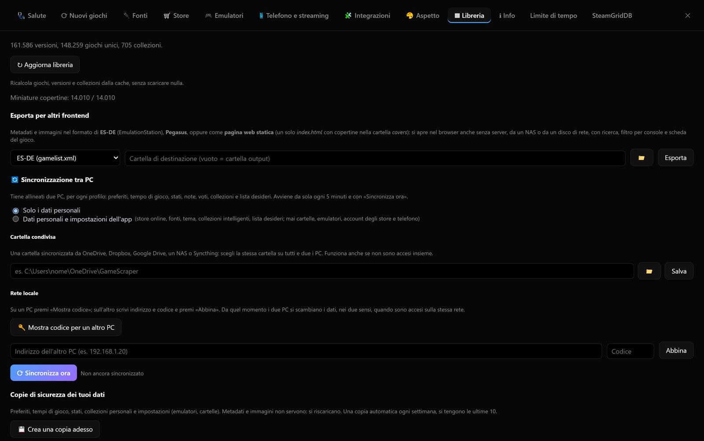
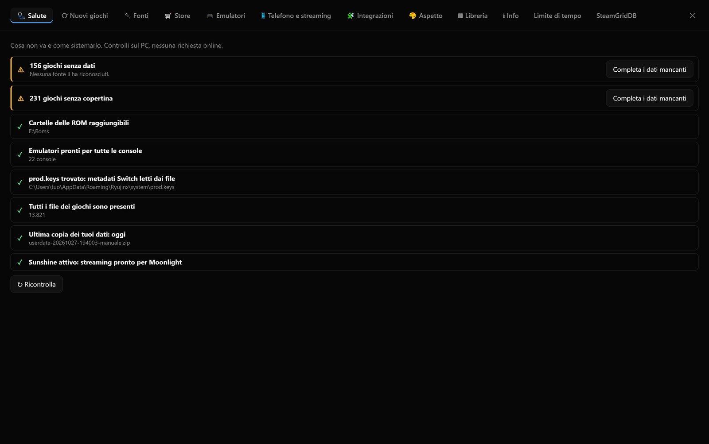

# Dati, copie di sicurezza e salute

## Sincronizzazione tra PC

Con due PC (per esempio fisso e portatile) **Impostazioni › Libreria › Sincronizzazione tra PC** tiene allineati i
dati personali di ogni profilo: preferiti, nascosti, stati, note, voti, versione principale, tempo di gioco e
partite, collezioni personali e modifiche alle collezioni, lista desideri. La sincronizzazione avviene da sola
all'avvio e ogni 5 minuti, oppure subito con **⟳ Sincronizza ora**.



### Cosa sincronizzare

| Scelta | Cosa passa da un PC all'altro |
|---|---|
| **Solo i dati personali** | I dati elencati sopra |
| **Dati personali e impostazioni dell'app** | In più: store online e altri store PC, fonti e loro limiti e account, console aggiunte, tema, plugin disattivati, collezioni intelligenti, impostazioni della lista desideri e di RetroAchievements |

Restano **sempre del singolo PC**: cartelle delle ROM, emulatori e profili di avvio, giochi aggiunti a mano, account
degli store PC (Steam, Epic, GOG…), telefono e streaming. La scelta va fatta uguale su tutti e due i PC.

### Due modi, anche insieme

**Cartella condivisa**: scegli una cartella sincronizzata da OneDrive, Dropbox, Google Drive, un NAS o Syncthing, la
**stessa** su tutti e due i PC, e premi **Salva**. Ogni PC ci scrive solo il suo file
(`GameScraper-sync/<profilo>/<pc>.json`), quindi il servizio di sincronizzazione non crea conflitti. Funziona anche
se i PC non sono mai accesi insieme.

**Rete locale**, senza servizi esterni:

1. sul primo PC premi **🔑 Mostra codice per un altro PC**: compaiono un codice di 6 cifre (vale 10 minuti, una volta
   sola) e l'indirizzo del PC;
2. sul secondo PC scrivi indirizzo e codice e premi **Abbina**.

Da quel momento il secondo PC scambia i dati con il primo, **nei due sensi**, quando sono accesi sulla stessa rete. La
comunicazione è cifrata (HTTPS) e il certificato del primo PC viene ricordato all'abbinamento: se cambia, lo scambio
si ferma e va rifatto l'abbinamento. Un PC abbinato può solo scambiare i dati di sincronizzazione, nient'altro. I PC
abbinati si scollegano dalla stessa sezione. Windows può chiedere di consentire l'app sulle reti private.

### Come si uniscono i dati

- Per ogni dato vince la **modifica più recente**: se togli un preferito sul portatile, sparisce anche dal fisso.
- Al primo collegamento i dati dei due PC si **uniscono**: i preferiti di entrambi restano preferiti.
- Il **tempo di gioco** si somma: ogni partita è registrata una volta sola, anche ripetendo la sincronizzazione.
- Le **cancellazioni** (collezioni, giochi della lista desideri) arrivano anche sull'altro PC.
- Lo stesso gioco si riconosce sui due PC anche se è in cartelle diverse (le ROM per contenuto, i giochi PC per il
  codice dello store).

## Copie di sicurezza dei tuoi dati

In **Impostazioni › Libreria › Copie di sicurezza dei tuoi dati** si salvano in uno zip preferiti, tempi di gioco,
stati, note, collezioni personali (di tutti i profili) e `settings.json`. Le copie stanno in `<cache>/backups`.

- **Copia automatica settimanale** all'avvio; si tengono le ultime 10.
- **Ripristino a caldo**: funziona con l'app aperta. Prima di ripristinare viene salvata una copia dei dati attuali,
  così il ripristino si può annullare.

La libreria (`library.db`) non serve copiarla: si ricostruisce da sola. Per i salvataggi dei giochi vedi
[Giocare](giocare.md#salvataggi).

## La pagina Salute

**Impostazioni › 🩺 Salute** controlla in un solo posto quello che va sistemato:

- cartelle ROM non raggiungibili (per esempio un disco scollegato);
- console senza un emulatore pronto;
- `prod.keys` mancante per i giochi Switch;
- giochi senza dati o senza copertina;
- giochi con i file non trovati;
- fonti online che non rispondono;
- Sunshine fermo o in avvio manuale;
- età dell'ultima copia dei tuoi dati.

Ogni problema ha il pulsante che lo risolve o porta all'impostazione giusta. Il controllo non fa richieste in rete.



## Cartelle rinominate o spostate

Se rinomini o sposti le cartelle dei giochi, la libreria vede i giochi vecchi come «file non trovati» e quelli nuovi
come giochi mai visti. In **Impostazioni › Nuovi giochi** l'app se ne accorge da sola e mostra
**⟲ N giochi sembrano rinominati o spostati**: abbina i giochi con file mancanti alle cartelle nuove (stessa
console e stessa dimensione, oppure nome simile) e **Riassocia i selezionati** li sposta con un clic. Dati
scaricati, tempo di gioco, preferiti e collezioni passano alla nuova posizione.

Prima della riassociazione viene salvata una copia dei database (`*.bak`). Funziona finché la libreria contiene ancora
i giochi con i vecchi percorsi, cioè **prima** di una ricostruzione. Da terminale:

```powershell
python -m gamescraper relink            # anteprima
python -m gamescraper relink --apply    # esegue
```

## Esportare per altri frontend

**Impostazioni › Libreria › Esporta per altri frontend** esporta metadati e immagini per:

| Frontend | Risultato |
|---|---|
| **ES-DE** | `gamelist.xml` più la cartella `downloaded_media` |
| **Pegasus** | `metadata.pegasus.txt` più le immagini |
| **Pagina web** | `index.html` più la cartella `covers` |

Da terminale: `gamescraper export-frontend --format esde`, `--format pegasus` oppure `--format html`.

### La pagina web

La pagina web è **un solo file più le copertine**, senza server e senza risorse esterne: si apre con doppio clic
(anche da `file://`), da un NAS, da un disco di rete o da un sito statico. Ha ricerca, filtro per console, ordinamento
e la scheda del gioco; le schede si disegnano man mano che si scorre, quindi funziona anche con migliaia di giochi.
Il titolo della pagina si sceglie nel campo accanto al formato.

## Dati scaricati

**Impostazioni › Info › Dati scaricati › ⟳ Calcola** mostra dove stanno i dati e quanto pesano: per cartella, per
console (immagini e video, metadati nel database, elenchi degli store online), per fonte dei metadati, per gli altri
dati e per singolo database.

## Ricostruire la libreria

La libreria si ricostruisce da sola dopo ogni scansione, aggiornamento degli store o importazione. A mano:
`python -m gamescraper library`. La ricostruzione non tocca i tuoi dati (`userdata.db`, `settings.json`).

## Log

- Il log normale dell'eseguibile, senza terminale, è in `<cartella dati>/logs/gamescraper.log`.
- Il log diagnostico dettagliato (store, pianificatore, errori) si attiva con `--log` o `GAMESCRAPER_LOG` (vedi
  [Log su file](store-online.md#log-su-file)).
