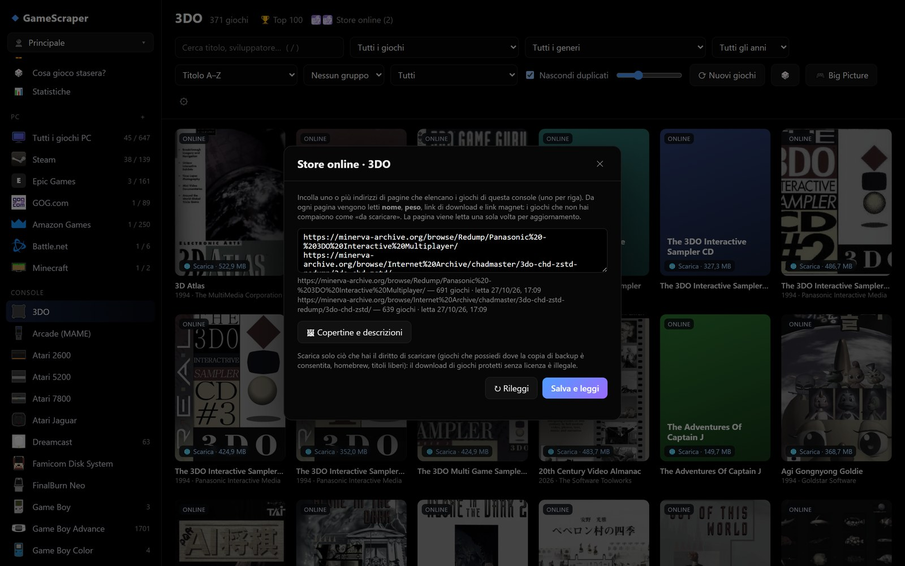
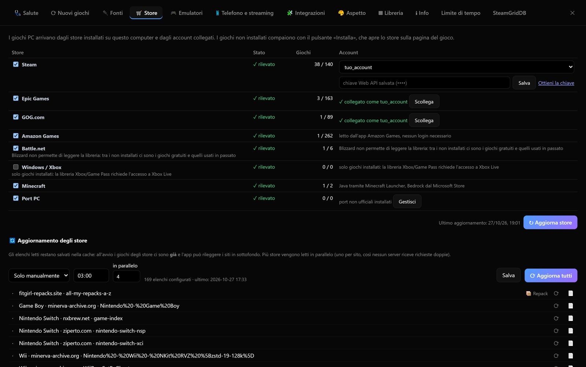

# Aggiungere store online e store PC

Oltre ai giochi che possiedi, Pozzo Launcher può mostrare i giochi **disponibili da scaricare** letti da pagine web che
scegli tu: i **cataloghi delle console** (store online) e gli **elenchi di giochi PC** non ufficiali (repack e
download diretto). Questi giochi compaiono nella libreria come «da scaricare», con un pulsante per ogni sito che li
offre.

> **Nota legale.** L'app non contiene né importa elenchi di siti: gli indirizzi li aggiungi tu. Scarica solo ciò che
> hai il diritto di scaricare (giochi che possiedi dove la copia di backup è consentita, homebrew, freeware, demo,
> titoli liberi): il download di giochi protetti senza licenza è illegale.

Questo capitolo spiega:

1. come aggiungere un catalogo a una console;
2. quali formati di pagina l'app sa leggere e come verificarli;
3. come aggiungere gli elenchi di giochi PC;
4. come funziona l'aggiornamento degli store (coda, pianificazione, log);
5. i plugin inclusi che aggiungono store in blocco;
6. per chi programma: come aggiungere un nuovo formato di pagina o un nuovo store.

## Store online di una console

### Aggiungere un catalogo

1. Apri la console nella barra laterale.
2. Premi **Store online** nella barra della console (il numero tra parentesi indica quanti cataloghi ci sono).
3. Incolla uno o più indirizzi di **pagine che elencano i giochi** di quella console, **uno per riga**.
4. Premi **Salva e leggi**.

Da ogni pagina vengono letti nome, peso, link di download e link magnet. I giochi che non hai compaiono come
**da scaricare** nella vista della console, nella vista **🛒 Store** e nelle classifiche. Quelli che possiedi già non
vengono ripetuti.

Nella stessa finestra:

- la tabella mostra per ogni indirizzo il numero di giochi letti, quando è stato letto e il formato riconosciuto;
- **↻ Rileggi** rilegge subito gli elenchi;
- togliere tutti gli indirizzi e salvare scollega la console dagli store online.



### Come compaiono i giochi

- Il titolo viene **ripulito** dalle parole dei siti: «Zumba World – The Marble Adventure Switch NSP (eShop)» diventa
  «Zumba World – The Marble Adventure». La parola «Switch» che fa parte del titolo resta («1-2-Switch»).
- **Stesso gioco da più fonti**: se due siti offrono lo stesso gioco, anche con nomi leggermente diversi, la libreria
  mostra **una sola scheda** con la pagina di ogni fonte («🌐 nxbrew.net ↗», «🌐 ziperto.com ↗») e il pulsante Torrent
  quando c'è un link magnet **per il singolo file**.
- **⬇ Scarica** apre direttamente i file elencati nella pagina del gioco, non la pagina dello store. La scheda
  mostra tutti i link disponibili, uno per provider, divisi per tipo: **gioco** (anche a parti: «Part 2», «Part 3»),
  **aggiornamento**, **DLC/espansioni** e le eventuali **versioni in altre lingue**. Il pulsante grande apre un link
  per tipo, tutti insieme e dalla stessa fonte; ogni provider si può aprire anche da solo.
- **Pubblicità saltata**: molti provider nascondono il file dietro un accorciatore (ouo.io). L'app apre il link vero
  al posto tuo, nella finestra nascosta dell'app, cliccando da sola i pulsanti del sito come farebbe lo userscript
  `ouo_skipper`; il risultato resta in cache, quindi la seconda volta l'apertura è immediata.
- **Torrent**: si offre solo per i magnet che indicano il file (nome con estensione); quelli che scaricherebbero
  l'intero set non hanno il pulsante, e la scheda lo dice, così non si scaricano decine di giochi per sbaglio.
- I giochi solo online **non contano come posseduti**: non entrano nel conteggio della console, in «Multigiocatore
  locale» né nei consigli basati sui tuoi giochi.
- Una console con uno store online compare nella barra laterale **anche se non hai nessun suo gioco**: così puoi
  sfogliarne il catalogo.

### Copertine e descrizioni

Le pagine elenco contengono solo i titoli. **🖼 Copertine e descrizioni** nella finestra *Store online* completa
le schede, con due barre di avanzamento (copertine e descrizioni) e un pulsante di stop:

1. **GameTDB** (solo Switch, offline): un database di circa 24.000 giochi scaricato una volta (circa 4 MB, valido
   30 giorni). Riempie in pochi secondi copertina, descrizione (prima in italiano), editore, giocatori. Le copertine
   mancanti in una regione vengono cercate nelle altre.
2. **Pagine dei siti**: per le voci ancora senza copertina o descrizione l'app legge la pagina del gioco (al massimo
   2 richieste al secondo) e ne ricava copertina, descrizione, Title ID, data, editore, generi, peso e schermate.
   Vanno bene sia i siti che scrivono «Genre: …» nel testo sia quelli con i dati in tabella (`<dl>` con `<dt>`/`<dd>`,
   come superpsx); le date estese («April 20, 2021») diventano `AAAA-MM-GG`.
3. **Ricerca per titolo** sui siti che la permettono, per le voci rimaste senza copertina (solo per le console del
   sito: la ricerca di Ziperto, per esempio, vale solo per Switch).

Il lavoro già fatto resta in cache (60 giorni): ogni esecuzione riprende da dove era rimasta. Gli elenchi di file
(formato `filelist`) sono esclusi: i loro dati arrivano dallo scraping normale.

## Formati di pagina riconosciuti

L'app sa leggere cinque strutture di pagina. Di solito **non serve sceglierle**: se il formato non è indicato,
viene riconosciuto dalla pagina stessa.

| Formato | Che pagina è | Paginazione | Esempio di struttura |
|---|---|---|---|
| `filelist` | Elenco di file o indice di cartella (Apache, nginx) | No | Link diretti ai file `.zip`, `.7z`, `.nsp`, … con il peso |
| `type_a` | Elenco paginato di schede | `?lcp_page0=N` | `<ul class="lcp_catlist">` con un link per gioco |
| `type_b` | Elenco A–Z su una pagina | No | `<div class="…-az-list">`, lettere `<h2 id="letter-X">`, giochi `<div class="…-game">` |
| `type_c` | Archivio di articoli (WordPress) | `/page/N/` | Ogni gioco è un `<article>` con titolo `h2.entry-title` |
| `type_d` | Elenco A–Z completo su una pagina | No | `div.az-listing` con sezioni per lettera e liste di link |

Dettagli utili:

- **filelist** filtra i link per estensione: tiene solo i file di giochi (più le estensioni della console). È il
  formato storico ed è quello usato quando nient'altro corrisponde.
- **type_a** e **type_c** leggono la prima pagina, ricavano il numero totale di pagine dal paginatore e leggono le
  altre in sequenza, con una pausa casuale tra una pagina e l'altra. Se il paginatore mostra solo «Next», si
  seguono i link fino in fondo.
- **type_a, type_b, type_c, type_d** puntano alla **scheda** del gioco, non a un file: non c'è filtro per
  estensione.
- Se un elenco paginato si accorcia, o cambi formato, le voci vecchie vengono tolte: in libreria non restano giochi
  fantasma.

### Indicare il formato a mano

Se il riconoscimento automatico sbaglia, il formato si indica in `settings.json`, sezione `catalogs`:

```json
{
  "catalogs": {
    "snes": ["https://esempio.test/roms/"],
    "nds":  { "urls": ["https://esempio-a.test/all/"], "type": "type_a" },
    "gba":  { "urls": ["https://esempio-b.test/all"], "type": "type_b",
              "css": { "az_list": "miosito-az-list", "game": "miosito-game" } }
  }
}
```

- La forma **lista di indirizzi** usa il riconoscimento automatico (o `filelist`).
- La forma **oggetto** ha `urls` (gli indirizzi) e le opzioni: `type` e, solo per `type_b`, `css` con le classi
  dei due elementi della pagina (`az_list` per il contenitore, `game` per ogni gioco).
- Cambiando gli indirizzi dalla finestra *Store online* il `type` e le opzioni restano.

### Verificare un indirizzo prima di aggiungerlo

Un errore tipico è incollare una pagina che non elenca **tutto** il catalogo (una categoria, un archivio parziale,
una singola pagina): si ottengono pochi giochi o nessuno. Il pulsante **🔍 Prova** (in *Altri store PC*) legge solo
quella pagina e risponde con formato, giochi nella pagina, pagine totali e i primi titoli:

```
✅ Formato type_c: 10 giochi in questa pagina, su 1.373 pagine. Esempi: …
⚠️ Formato filelist: 0 giochi in questa pagina, su una sola pagina.
```

- Più pagine: l'indirizzo è un indice completo, l'app le leggerà tutte.
- Pochi giochi e una sola pagina: probabilmente non è l'elenco completo. Cerca la pagina «tutti i giochi» del sito,
  spesso chiamata *All*, *Archive*, *A–Z* o *Index*.

## Altri store PC

In **Impostazioni › Store › Altri store PC (non ufficiali)** si aggiungono elenchi di giochi PC che non sono store
ufficiali, in due categorie:

| Categoria | Cos'è |
|---|---|
| **📦 Repack** | Giochi molto compressi: download più corto, installazione più lunga. Adatti a una connessione lenta |
| **⬇ Download diretto** | Il gioco così com'è |

Per aggiungerne uno:

1. incolla l'**indirizzo dell'elenco** e scegli la **categoria**;
2. **🔍 Prova** per controllare formato e numero di giochi;
3. **Aggiungi**;
4. **↻ Leggi gli elenchi** legge tutti gli elenchi e ricostruisce la libreria.

Gli elenchi usano gli stessi formati delle console, con il riconoscimento automatico. I giochi diventano giochi PC
da scaricare: compaiono nella sezione PC, nei filtri e nella scheda come gli altri giochi PC. La scheda mostra la
categoria («📦 Repack (download corto, installazione lunga)» oppure «⬇ Download diretto») e un pulsante per ogni
fonte. Lo stesso gioco su più siti è una scheda sola.

Nella tabella degli elenchi c'è un filtro *Tutti / 📦 Repack / ⬇ Download diretto*, e per ogni riga si cambia
la categoria o si rimuove l'elenco. In `settings.json` gli elenchi stanno in `pc_stores`:

```json
{ "pc_stores": [ { "url": "https://esempio.test/giochi/", "kind": "repack" },
                 { "url": "https://altro.test/a-z/", "kind": "direct" } ] }
```

## Aggiornamento degli store

Gli elenchi letti restano salvati nella cache: all'avvio i giochi degli store ci sono **subito**, e l'aggiornamento
gira in sottofondo senza bloccare l'interfaccia. In **Impostazioni › Store › 🔄 Aggiornamento degli store** si
sceglie quando rileggerli:

| Modalità | Comportamento |
|---|---|
| **All'avvio dell'app** (predefinita) | Rilegge tutti gli elenchi poco dopo l'avvio |
| **Ogni giorno alle** | Una volta al giorno all'ora scelta, con l'app aperta |
| **Solo manualmente** | Mai in automatico: si usa **⟳ Aggiorna tutti** |



### La coda

- **Più elenchi in parallelo**: fino al numero impostato in *in parallelo* (4 di default, da 1 a 8), **mai due
  elenchi dello stesso sito insieme**, per non sovraccaricarlo.
- Premendo **⟳** su più store, ognuno entra **in coda** e parte appena si libera un posto. **⟳ Aggiorna tutti**
  accoda tutti quelli configurati. Aggiungere uno store mentre una lettura è in corso lo accoda invece di rifiutarlo;
  la stessa coda è usata dal pulsante ⟳, da *Leggi gli elenchi*, dalla finestra *Store online* delle console e dal
  plugin Link → Store.
- A coda vuota la libreria si ricostruisce **una volta sola**.
- **■ Interrompi** ferma la lettura a fine pagina, anche a metà di un elenco da centinaia di pagine, e svuota la
  coda. Il pulsante sparisce quando non c'è più niente da fermare.
- Un sito irraggiungibile non blocca gli altri: la sua riga resta con l'errore e gli elenchi già salvati restano
  validi.

### L'elenco degli store

La tabella mostra sempre tutti gli store configurati. Per ogni riga:

| Colonna | Significato |
|---|---|
| Stato | `·` mai letto, ⏳ in corso, ✓ fatto, ✕ errore, ⏭ saltato |
| Coda | Posizione in coda |
| Avanzamento | Pagina corrente su totale, secondi per pagina, tempo rimanente stimato |
| Log | L'ultima riga di log; **📄** apre il log completo di quello store |
| ⟳ | Accoda solo questo store |

### Log su file

Per capire perché un sito è lento o non risponde si avvia l'app con il log su file:

```bat
python -m pozzo app --log                   :: <cache>\logs\diagnostica.log
python -m pozzo app --log C:\temp\gs.log    :: percorso a scelta
set POZZO_LOG=1 && python -m pozzo app
```

Il file contiene, con ora e categoria, le decisioni del pianificatore (modalità, orario, avvio rimandato e perché),
l'apertura e la chiusura di ogni elenco, **ogni pagina letta** (`… pagina 51/147 — 50 giochi`) e gli errori con
tipo e messaggio. Oltre 8 MB viene troncato (la parte vecchia va in `.log.old`). Il percorso attivo è mostrato in
**Impostazioni › Store**.

## Plugin che aggiungono store

### Link → Store

Molti siti raccolgono **elenchi di altri siti**. Il plugin **Link → Store** (attivo da **Impostazioni › Aspetto ›
Plugin**, voce *Link → Store* nella barra laterale) legge una di queste pagine:

1. incolla l'indirizzo della pagina e premi **Leggi i link**;
2. i link vengono **raggruppati per intestazione** (h2/h3 della pagina) e filtrabili;
3. per ogni link scegli la destinazione: una **console** (diventa un suo store online) oppure **store PC** con la
   categoria (📦 Repack o ⬇ Download diretto);
4. il plugin lo aggiunge alle impostazioni (subito, senza riavviare) e indica se era già configurato;
5. **↻ Leggi gli store aggiunti** accoda la lettura: l'avanzamento è in **Impostazioni › Store**.

### Store Minerva

Il plugin **Store Minerva** (voce nella barra laterale) aggiunge allo store online di ogni console le cartelle di
minerva-archive.org elencate su r-roms.github.io, poi ne legge l'elenco dei giochi. **Importa da r-roms** mostra il
log dell'importazione; i link già presenti restano e **non vengono riletti**: si aggiungono e si leggono solo gli store
nuovi per quella console (più quelli presenti ma mai letti, per esempio dopo aver aggiunto una console). Al termine la
libreria si ricostruisce.

Per **Switch** aggiunge anche tre elenchi completi **preimpostati**: l'indice dei giochi di NXBrew (formato `type_b`),
Ziperto NSP (`type_c`) e Ziperto XCI (`type_d`). Per **PS4** e **PS5** preimposta l'archivio di superpsx
(`type_c`, letto come i siti di ROM). Quando una console ha più elenchi di formati diversi, il plugin
toglie il tipo fisso da `settings.json`, così ogni pagina viene riconosciuta da sola.

## Per chi programma

### Un nuovo formato di pagina

I formati sono un registro in `pozzo/catalog.py`:

```python
PARSERS = {
    "filelist": _parse_filelist,
    "type_a": parse_type_a_index,
    "type_b": parse_type_b,
    "type_c": parse_type_c_index,
    "type_d": parse_type_d_index,
}
```

Per aggiungerne uno:

1. scrivi `parse_type_x(page, base_url, exts=None, config=None)` che restituisce una lista di voci
   `{"name", "size", "url", "magnet"}` (oppure `(voci, pagine_totali)` se la pagina è paginata);
2. registrala in `PARSERS`;
3. se serve, aggiungi il riconoscimento automatico in `detect_kind()`.

Lettura, cache, potatura delle voci vecchie, costruzione della libreria e API funzionano senza altre modifiche. I
test stanno in `tests/catalog/` e sostituiscono solo il confine HTTP (`catalog._get_page`): nessuna richiesta di
rete.

### Un nuovo store (fornitore di libreria)

Uno store nuovo, per esempio un launcher che l'app non conosce, si aggiunge con un **plugin** (vedi
[Temi e plugin](ESTENSIONI.md)). Il backend del plugin registra una sottoclasse di `StoreProvider` il cui metodo
`fetch()` restituisce i giochi come `StoreGame`:

```python
# plugins/mio-launcher/backend.py
import json
from pathlib import Path

from pozzo.stores.base import StoreGame, StoreProvider


class MioLauncher(StoreProvider):
    id = "miolauncher"
    name = "Mio Launcher"

    LIBRARY = Path.home() / "MioLauncher" / "library.json"

    def detected(self) -> bool:
        return self.LIBRARY.exists()  # lo store compare solo se il launcher e' installato

    async def fetch(self) -> list[StoreGame]:
        games = []
        for g in json.loads(self.LIBRARY.read_text(encoding="utf-8")):
            games.append(StoreGame(
                store=self.id, id=str(g["id"]), title=g["name"],
                installed=bool(g.get("path")), install_dir=g.get("path", ""),
                launch={"type": "uri", "target": f"miolauncher://run/{g['id']}"},
                install_uri=f"miolauncher://install/{g['id']}",
            ))
        return games


def register(gs):
    gs.add_store(MioLauncher)
```

Campi principali di `StoreGame`:

| Campo | Significato |
|---|---|
| `store`, `id`, `title` | Store, identificativo del gioco nello store, titolo |
| `installed`, `install_dir` | Se è installato e dove |
| `launch` | Come avviarlo: `{"type": "uri", "target": "…"}` oppure `{"type": "exe", "target": percorso, "args": [], "cwd": ""}` |
| `install_uri` | Indirizzo che apre il client dello store sulla pagina d'installazione |
| `page` | Pagina web dello store |
| `playtime`, `last_played` | Tempo di gioco (secondi) e ultima partita, se lo store li fornisce |
| `images` | Immagini per tipo (`cover`, `hero`, `logo`, `icon`, `header`) → indirizzo |
| `genres`, `description`, `developer`, `publisher`, `release_date`, `size`, `reviews` | Metadati facoltativi |

Lo store nuovo compare in **Impostazioni › Store** e i suoi giochi nella sezione PC, con avvio, tempo di gioco e
unione con lo stesso gioco degli altri store come per gli store inclusi. Gli store inclusi
(`pozzo/stores/`) sono buoni esempi: `manual.py` è il più semplice, `steam.py` ed `epic.py` mostrano account e
giochi non installati.
