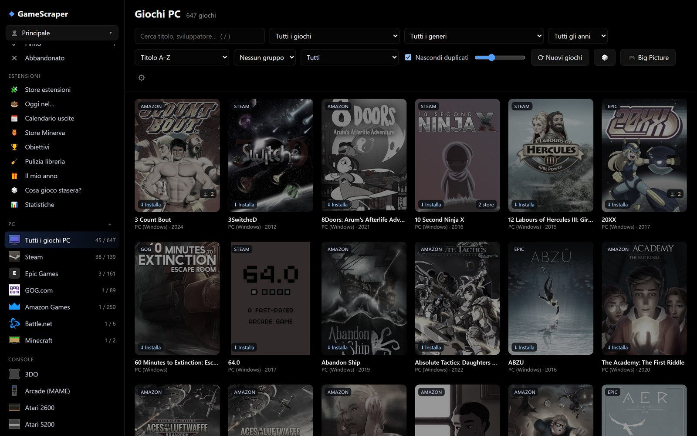

# Giochi PC dagli store

La sezione **PC** della barra laterale raccoglie i giochi degli store ufficiali installati su questo computer. Ci sono
sia i giochi **installati** sia quelli **posseduti ma non installati**: questi compaiono in grigio con il pulsante
**⬇ Installa**, che apre il client dello store direttamente sulla pagina del gioco.

## Store supportati

| Store | Installati | Non installati | Cosa serve |
|---|---|---|---|
| Steam | file locali | sì | Chiave Web API gratuita |
| Epic Games | file locali | sì | **Collega account**: accesso dalla pagina ufficiale di Epic |
| GOG.com | registro di Windows | sì | **Collega account**: accesso dalla pagina ufficiale di GOG |
| Amazon Games / Prime Gaming | sì | sì | Automatico, letto dall'app Amazon Games |
| Battle.net | sì | giochi gratuiti e già usati | Blizzard non offre l'elenco dei giochi posseduti |
| Windows / Xbox | sì | no | Servirebbe l'accesso a Xbox Live |
| Minecraft | Java e Bedrock | sì (Microsoft Store) | Automatico |

Gli store si attivano e disattivano in **Impostazioni › Store**; lì si collegano anche gli account. Una scelta
cambiata vale dal prossimo aggiornamento della libreria.

### Steam

Per vedere anche i giochi **non installati** serve una chiave Web API gratuita
(steamcommunity.com/dev/apikey). Senza chiave l'app legge comunque i giochi installati dai file locali. Lo SteamID è
quello dell'account usato più di recente sul PC, oppure si indica in `[stores.steam] steamid`.

### Epic Games e GOG

**Collega account** apre la pagina ufficiale di accesso dello store in una finestra dell'app; al termine l'app riceve
il codice di autorizzazione e da quel momento legge l'elenco dei giochi posseduti. La password non passa mai
dall'app.

## Aggiungere un gioco qualsiasi

Con **＋** accanto a *PC* scegli un `.exe`: il gioco entra in libreria tra i giochi PC. Copertina e immagini vengono
cercate su Steam e IGDB. I giochi aggiunti a mano sono salvati nei tuoi dati e non vengono toccati dalle
ricostruzioni della libreria.

Nel campo **Tipo** scegli **Gioco** o **Applicazione**: le applicazioni (un programma che non è un gioco) finiscono
nella vista **🧩 Applicazioni** invece che tra i giochi, e si avviano allo stesso modo. Le voci aggiunte due volte
per sbaglio si tolgono con **🧹 Rimuovi doppioni manuali** nell'estensione *Pulizia libreria*.

### Giochi browser (URL)

Nello stesso dialogo scegli **Tipo › Browser / URL** (es. `https://www.chess.com`), inserisci l'URL e, se vuoi, un
titolo; **Aggiungi** salva il gioco. **Gioca** apre l'URL nel browser predefinito (il tempo di gioco non viene
misurato). Titolo (se lasci vuoto il campo), descrizione e immagine di copertina si leggono dai tag statici della
pagina (`og:title`, `og:description`, `og:image`, con ripiego su `<title>` e `meta description`), senza JavaScript
né dipendenze aggiuntive, e restano salvati: si vedono nella libreria e nella scheda del gioco.

Per sicurezza l'URL è trattato come input non attendibile: sono ammessi solo `http` e `https`; host locali
(`localhost`, `.local`, nomi senza dominio) e indirizzi IP privati, loopback o link-local sono rifiutati, anche
dopo un redirect. Il controllo vale anche per l'immagine di copertina e per ogni redirect, ed è fatto sull'indirizzo IP realmente
usato dalla connessione (contro il DNS rebinding); i proxy di sistema non vengono usati per queste richieste.
La lettura ha limiti: 8 secondi di timeout, 1 MB di HTML, al massimo 5 redirect. Se il sito non
risponde il gioco viene aggiunto lo stesso e l'app mostra l'errore (es. «Tempo scaduto nel contattare il sito»).
Il flusso dei giochi `.exe` e delle applicazioni non cambia.

L'aggiunta è immediata e non avvia nessun aggiornamento degli store: la voce compare subito, mentre copertina e
immagini arrivano in sottofondo.

## Stesso gioco su più store

Un gioco posseduto su più store (per esempio Steam ed Epic) è **una scheda sola** con più versioni. La versione
principale è quella installata. Preferiti, stato e tempo di gioco valgono per tutte.

## Metadati dei giochi degli store

Descrizioni, generi, immagini e valutazioni arrivano dagli store stessi quando li forniscono (per esempio le
recensioni di Steam), poi da IGDB e dalle altre fonti. La finestra **📚 Metadati dei giochi degli store** completa i
dati mancanti dei giochi PC.

## Tempo di gioco

Il tempo di gioco viene registrato anche per i giochi avviati tramite un launcher, riconoscendo il processo del gioco
nella sua cartella. Steam fornisce anche il suo tempo totale.

## Script, launcher e collegamenti

Anche per i giochi PC valgono gli **script prima e dopo il gioco** (per tutti i giochi o nel **⚙ Profilo di avvio**
del singolo gioco), la **chiusura automatica del launcher** a fine partita e il **🖥 Collegamento sul desktop**:
sono spiegati in [Giocare](giocare.md#script-prima-e-dopo-il-gioco).

## Store non ufficiali

Gli elenchi di giochi PC che **non** sono store ufficiali (siti di repack o di download diretto) si aggiungono nella
stessa scheda, sezione **Altri store PC**: sono spiegati nel capitolo [Aggiungere store](store-online.md#altri-store-pc).
