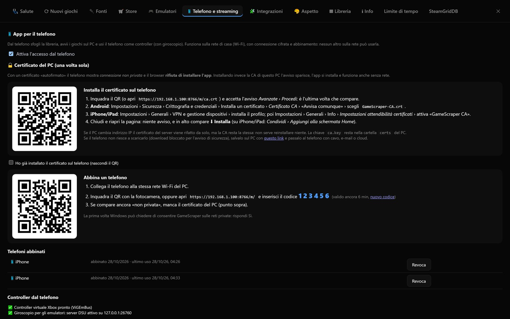
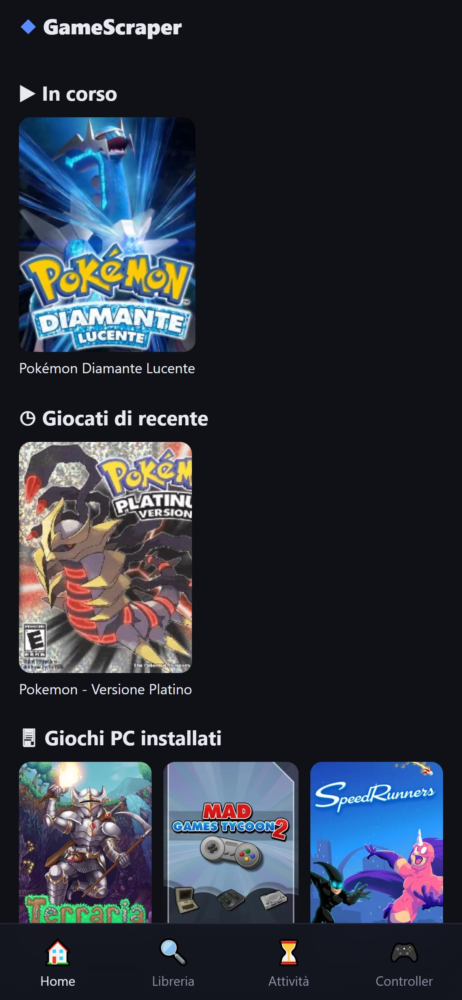

# Telefono e streaming

Il telefono (o il tablet) può fare tre cose con Pozzo Launcher:

1. **telecomando della libreria**: sfogliare i giochi, avviarli e chiuderli sul PC;
2. **controller**: tasti a schermo, giroscopio, fino a 4 telefoni per 4 giocatori;
3. **schermo**: giocare sul telefono, sulla TV o su un altro PC con lo streaming Sunshine + Moonlight;
4. **amico a distanza**: far entrare un amico nel gioco come secondo giocatore, con il suo telefono come controller.

Tutto si configura in **Impostazioni › 📱 Telefono e streaming**.

## L'app per il telefono

### Attivarla e abbinare il telefono

1. **Attiva l'accesso dal telefono**. L'app pubblica sulla rete di casa una web app in HTTPS.
2. **Installa una volta il certificato del PC** (vedi sotto): senza, il telefono mostra «connessione non privata» e il
   browser **rifiuta di installare l'app**.
3. Inquadra il **QR** dell'abbinamento con il telefono. Il codice ha 6 cifre, vale 10 minuti e si usa una volta sola.
4. Tocca **⬇ Installa** in alto (su iPhone/iPad: *Condividi › Aggiungi alla schermata Home*): l'app parte a tutto
   schermo e la **libreria resta consultabile anche quando il Wi-Fi va e viene** (copertine comprese); i comandi che
   modificano qualcosa (avvio, preferiti, controller) richiedono la connessione.

Windows può chiedere di consentire l'app sulle reti private: rispondi Sì.

### Installare l'app: il certificato HTTPS

Il server del telefono parla HTTPS, ma con un certificato **fatto in casa**. Un certificato non fidato produce due
effetti: l'avviso «connessione non privata» e, soprattutto, il **rifiuto del service worker** da parte del browser —
quindi niente installazione e niente uso senza rete. La soluzione è fidarsi del PC una volta sola.

Attenzione a cosa fa il profilo: **non attiva l'HTTPS** (c'è già, la pagina è `https://<ip>:8766/m/`), serve a dire al
telefono «questo certificato è legittimo». HTTPS è due cose insieme: connessione cifrata e **identità** del server
certificata da qualcuno. Un sito pubblico si fa certificare da un'autorità pubblica (serve un dominio e internet);
qui l'autorità sei tu, sul PC, e installare `PozzoLauncher-CA.crt` una volta sul telefono la rende riconosciuta. Con un
certificato fidato il service worker viene accettato e l'app si installa. Senza profilo, su iPhone puoi ancora usare
*Condividi › Aggiungi alla schermata Home*, ma resta un semplice collegamento: niente uso senza rete e niente
giroscopio (anche i sensori richiedono una connessione considerata sicura).

Sul PC: **Impostazioni › 📱 Telefono e streaming › 🔒 Certificato del PC**. Si inquadra il QR (o si apre
`https://<ip-del-pc>:8766/m/ca.crt`) e si installa il file `PozzoLauncher-CA.crt`:

- **Android**: Impostazioni › Sicurezza › Crittografia e credenziali › Installa un certificato › *Certificato CA* ›
  «Avvisa comunque» › scegli il file appena scaricato. Chrome si fida delle CA installate dall'utente.
- **iPhone/iPad**: Impostazioni › Generali › VPN e gestione dispositivi › installa il profilo; poi Impostazioni ›
  Generali › Info › *Impostazioni attendibilità certificati* › attiva l'interruttore di «Pozzo Launcher CA» (senza questo
  passaggio il certificato non è fidato).

Poi si chiudono e si riaprono le schede del browser: l'avviso sparisce e l'app si installa. Note utili:

- **Apertura immediata**: una volta installata, la pagina e la libreria arrivano dalla copia sul telefono e si
  aggiornano in sottofondo; sul PC l'ultima risposta della libreria resta pronta, così non viene ricostruita a ogni
  apertura. Con decine di migliaia di giochi la differenza si vede (da qualche secondo a poche centinaia di
  millisecondi).
- La CA resta la **stessa per 10 anni**: se il PC cambia indirizzo IP cambia solo il certificato del server (rifatto e
  firmato da solo) e il telefono continua a fidarsi — non si reinstalla niente.
- Il file `ca.key` nella cartella `certs` accanto alle impostazioni è la chiave che rende il PC fidato: non va copiata
  su altri PC né condivisa. Per togliere la fiducia basta rimuovere la CA dalle impostazioni del telefono.
- Su iPhone l'installazione delle app (PWAs) è possibile **solo da Safari**, non da Chrome o Firefox.
- Se il telefono continua a dire «non privata»: manca l'attivazione della fiducia (iOS), la CA è stata installata come
  certificato «Wi-Fi/VPN» invece che «CA» (Android), oppure la pagina è ancora aperta: chiudi tutte le schede e riapri.
- Se il telefono **blocca il download** del certificato (capita finché la pagina è segnalata come non sicura), in
  Impostazioni › Telefono e streaming c'è il link che salva `PozzoLauncher-CA.crt` **sul PC**: passalo al telefono con
  cavo, e-mail, cloud o AirDrop, poi installalo come sopra.
- Se hai perso la cartella `certs` (o hai ripristinato un backup su un PC nuovo) viene creata una CA nuova: i telefoni
  vanno rifidati una volta sola.
- In alternativa alla CA locale si può usare un dominio pubblico con certificato valido (per esempio un tunnel
  Cloudflare o Tailscale, vedi [Giocare con un amico a distanza](#giocare-con-un-amico-a-distanza)): serve però una
  connessione a internet e un servizio esterno.

### Sicurezza

Senza abbinamento il telefono non raggiunge niente. Anche abbinato può solo sfogliare la libreria, avviare e chiudere
i giochi, fare schermate, fare da controller e premere i tasti del **telecomando** (un elenco chiuso: mai testo
digitato): le impostazioni e i file del PC restano fuori portata. L'**ospite a distanza** ha solo il controller.

### Cosa si fa dal telefono

- Home con *In corso*, *Giocati di recente*, *Preferiti* e giochi PC installati; ricerca e filtro per console.
- **Libreria** con ordinamento per titolo, anno, valutazione, tempo di gioco e ultimo avviato, e i filtri *Tutti*,
  *Recenti*, *★ Preferiti*, *▶ In corso*, *📋 Da giocare*.
- **⏳ Attività**: i lavori del PC in corso — ricerca nuovi giochi, store ufficiali e online, copertine e descrizioni,
  durate, migliori giochi, immagini delle collezioni, database locali, ricostruzione della libreria — con la
  percentuale, più i comandi **Aggiorna store**, **Cerca nuovi giochi**, **Ricostruisci libreria**, **Chiudi gioco** e,
  mentre la ricerca è in corso, **Interrompi ricerca**. Le attività terminate si possono rimuovere dalla finestra
  Attività, singolarmente o con i comandi di pulizia. Nella stessa scheda c'è anche il **🎛 Telecomando del PC**.
- Scheda del gioco con **Avvia**, stato, preferito e **Togli da Giocati di recente**.
- **Schermate** del gioco in corso.
- **🎛 Telecomando del PC**: volume, muto, play/pausa e brano successivo, più Esc, Invio, Indietro, Alt+Tab, schermo
  intero e menu Start. Ogni tocco è un tasto premuto e rilasciato sul PC (nessun testo digitato: l'elenco è chiuso).
- **📱 Gioca su questo telefono**: avvia il gioco sul PC e spiega come entrarci da Moonlight con un tocco, tramite
  l'app **▶ Gioco in corso** pubblicata in Sunshine. Aprire Moonlight direttamente su un gioco da una pagina web non è
  possibile (né su iOS né su Android).

## Il telefono come controller

Il controller sullo schermo diventa un **controller Xbox virtuale** sul PC: serve il driver **ViGEmBus**. Fino a 4
telefoni = 4 giocatori.

Il pulsante **🏠** in alto chiude il controller e torna alla Home, anche col telefono in verticale; i titoli lunghi si
accorciano, così la barra dei comandi non esce dallo schermo.

### Aspetti del controller

In ⚙ › **Aspetto del controller**:

| Aspetto | Per cosa |
|---|---|
| **Xbox** | Il layout predefinito |
| **PlayStation** | Croce in alto a sinistra, levette in basso, △ ○ ✕ □ con i loro colori, L1/L2/R1/R2 |
| **Nintendo Switch** | Pro Controller: X in alto, A a destra, B in basso, Y a sinistra |
| **GameCube** | A grande, C-stick giallo, tasti per lettera |
| **Arcade** | 6 tasti, per i picchiaduro |
| **Buzz!** | Pulsante rosso grande e 4 colori, telefono in verticale; un telefono per giocatore |
| **Wii Remote** | In verticale o in orizzontale (come un NES), anche con **Nunchuk**: tasti, levetta, inclinazione, scuotimento e puntatore arrivano a Dolphin |
| **Volante** | Si sterza inclinando il telefono, pedali a pressione, *Centra* |
| **Chitarra** | Guitar Hero / Rock Band: 5 tasti colorati, plettro, leva del vibrato, Star Power |
| **Pistola ottica / touchpad** | Il telefono muove il mouse del PC (GunCon, Zapper, pennino del DS). Va permesso sul PC |
| **Microfono** | SingStar: la voce va in un cavo audio virtuale del PC (per esempio VB-Cable) che PCSX2 usa come microfono |

Con il layout Switch i tasti mandano al PC la stessa **posizione** di un controller Xbox (valgono le impostazioni che
l'emulatore ha già per i controller veri); un'opzione fa mandare invece la **lettera** (A Nintendo = A Xbox).

**Aspetto automatico**: con un gioco PlayStation in corso il telefono passa da solo al layout PlayStation, con un gioco
Switch al layout Switch, e lo stesso per GameCube, Wii e per i giochi Buzz!, Guitar Hero/Rock Band e SingStar.
Si disattiva in ⚙.

### Tasti personalizzabili

⚙ › **Sposta e ridimensiona i tasti**: si trascina ogni gruppo (levette, croce, tasti azione, dorsali, tasti
centrali) e se ne cambia la dimensione. La posizione si salva per ogni aspetto, in percentuale dello schermo;
**Ripristina** torna a quella originale.

Queste impostazioni — aspetto, sensibilità, inversione degli assi e posizioni dei tasti — si salvano **sul PC**, non
nel browser del telefono: valgono per tutti i telefoni abbinati, finiscono nei backup e non si perdono ricollegando il
telefono. Restano invece sul singolo telefono la dimensione dei comandi e la vibrazione alla pressione, che dipendono
dal suo schermo.

### Giroscopio

- **Movimento**: il protocollo DSU (cemuhook) su `127.0.0.1:26760` per Cemu, Ryujinx, Dolphin, Azahar/Citra.
  Nell'emulatore scegli la sorgente di movimento DSU.
- **🎯 Mira**: l'inclinazione muove la levetta destra, per i giochi senza giroscopio.

### Vibrazione

Quando il gioco fa vibrare il controller virtuale, vibra il telefono, con impulsi più lunghi per vibrazioni più forti.
Funziona su Android; Safari su iPhone e iPad non permette la vibrazione alle pagine web.

### Controller Bluetooth collegato al telefono

Se al telefono o al tablet è collegato un controller Bluetooth (PS5, PS4, Xbox, Switch Pro, MFi), l'app lo usa come
controller del PC al posto dei tasti a schermo. Il pulsante 🎮 sceglie *Auto*, *A schermo* o *Il mio*.

### Sala giocatori

Ogni telefono ha un **numero e un colore di giocatore**, visibili sul telefono e sul PC. I telefoni si scambiano il
posto senza ricollegarsi. Il numero è quello che vedono giochi ed emulatori (indice XInput).

### Prova controller

Sul PC, **Impostazioni › 📱 Telefono e streaming › 🎮 Prova controller** mostra in tempo reale cosa arriva da ogni
telefono: i pulsanti premuti, i grilletti (LT/RT), le due levette e il giroscopio attivo. **📳 Vibra** fa vibrare quel
telefono. Serve a capire in un colpo d'occhio se un tasto non arriva, se una levetta è fuori centro o se la vibrazione
funziona, senza aprire giochi o emulatori.

### Configurazione automatica degli emulatori

Alcuni controller speciali richiedono impostazioni nell'emulatore. L'app le scrive da sola:

- **PCSX2** per Buzz! o per la chitarra;
- **Dolphin** per il Wii Remote: server DSU, profili «Pozzo Launcher Telefono N», Wii Remote 1…N.

I file originali vengono copiati prima; **Annulla** rimette le impostazioni dell'emulatore com'erano.

## Giochi DS e 3DS: il telefono come secondo schermo

Nei giochi DS e 3DS il telefono collegato fa da **schermo inferiore**: mostra quello che il gioco disegna in basso e
manda i tocchi al PC, che tiene lo schermo superiore a schermo intero. Funziona con melonDS, Citra, Azahar e Lime3DS
(solo su Windows) e il telefono deve essere collegato **prima** di avviare il gioco: è lì che l'app prepara
l'emulatore a finestre separate, e a fine partita rimette la configurazione com'era.

- Col telefono in **verticale** lo schermo touch sta in alto e croce e tasti in basso; in **orizzontale** lo schermo
  prende tutta l'altezza e i comandi gli stanno sopra, semitrasparenti.
- Mentre il telefono è collegato il secondo schermo **non compare sul PC**. Ricompare, in un riquadro dietro allo
  schermo superiore, se il telefono si scollega o se non lo si tocca per un po': il tempo si sceglie in
  **Impostazioni › 📱 Telefono e streaming** (*Se il telefono non si usa per… secondi*; 30 di base, da 5 a 600).
- L'opzione **Il telefono fa da schermo touch nei giochi DS e 3DS** della stessa pagina spegne la funzione: in quel caso
  il PC mostra sempre i due schermi.

## Streaming con Sunshine e Moonlight

Per giocare **lontano dal PC** (telefono, tablet, TV, un altro PC) si usano
[Sunshine](https://app.lizardbyte.dev/Sunshine), sul PC, e [Moonlight](https://moonlight-stream.org), sul
dispositivo che guarda.

### Pubblicare i giochi in Moonlight

**Pubblica in Moonlight** aggiunge a Sunshine l'app «Pozzo Launcher Big Picture» e i tuoi giochi principali con le
copertine; le altre app di Sunshine restano. Moonlight avvia `pozzo-cli play --key …`, che resta aperto finché
giochi: lo streaming si chiude da solo a fine partita.

### Sunshine sempre pronto

Se Sunshine è fermo o impostato su avvio manuale, Moonlight non trova il PC. **▶ Avvia Sunshine** lo avvia e lo
imposta per partire con Windows, con una sola richiesta dei permessi di amministratore. La scheda avvisa se è in
avvio manuale e la pagina **Salute** segnala quando è fermo.

### Ottimizza lo streaming

**⚡ Ottimizza lo streaming** controlla:

- Sunshine avviato e configurato per partire con Windows;
- il preset dell'encoder NVIDIA, il two-pass e la correzione degli errori;
- se il PC è collegato via cavo o in Wi-Fi.

Per ogni problema dà le istruzioni per correggerlo, più i consigli per TV, box e telefono: Modalità Gioco della TV,
cavo di rete, frame pacing, bitrate, statistiche di Moonlight, e un box dedicato (Nvidia Shield, Apple TV 4K,
Google TV Streamer) al posto dell'app della TV, che decodifica molto più in fretta.

### Come giocare: TV, telefono, iPad

- **TV**: il controller si collega in Bluetooth alla TV (o al box); gli input arrivano al PC come controller Xbox
  virtuale tramite Moonlight → Sunshine → ViGEmBus.
- **Telefono o iPad**: tasti a schermo di Moonlight o un controller Bluetooth.
- **Telefono come controller** di un gioco mostrato sulla TV o sul monitor: con l'app del telefono descritta sopra.

## Giocare con un amico a distanza

Un amico entra nella tua partita da casa sua: il suo telefono fa da **secondo controller** e il video arriva con
**Moonlight**. Il PC resta tuo — l'ospite non vede la libreria, non tocca le impostazioni e non muove il mouse.

1. In **Impostazioni › 📱 Telefono e streaming › 🎮 Gioca con un amico a distanza** scegli come raggiungere il PC da
   fuori casa e incolla il suo **indirizzo pubblico**: un tunnel Cloudflare (`cloudflared tunnel --url
   https://localhost:8766`), ngrok o Tailscale Funnel. Lasciandolo vuoto l'invito vale solo sulla rete di casa.
2. Premi **Crea invito per un amico** e mandagli il **link** e il **codice di 6 cifre**. L'invito dura 10 minuti, vale
   una volta e per un ospite solo; per farlo entrare di nuovo serve un invito nuovo.
3. L'amico apre il link, scrive il codice e il suo nome, e si ritrova il controller già aperto: il suo telefono è il
   controller del **giocatore 2** (o del primo posto libero).
4. **Video**: l'amico installa [Moonlight](https://moonlight-stream.org), aggiunge il PC all'indirizzo che gli dai (da
   fuori casa serve una rete privata, per esempio Tailscale) e scrive nella pagina dell'invito il **PIN di 4 cifre** che
   Moonlight mostra: il PC lo conferma da solo, senza aprire l'interfaccia di Sunshine.

La lista **Ospiti** ha **Togli**, come per i telefoni: l'ospite esce subito dal controller.
